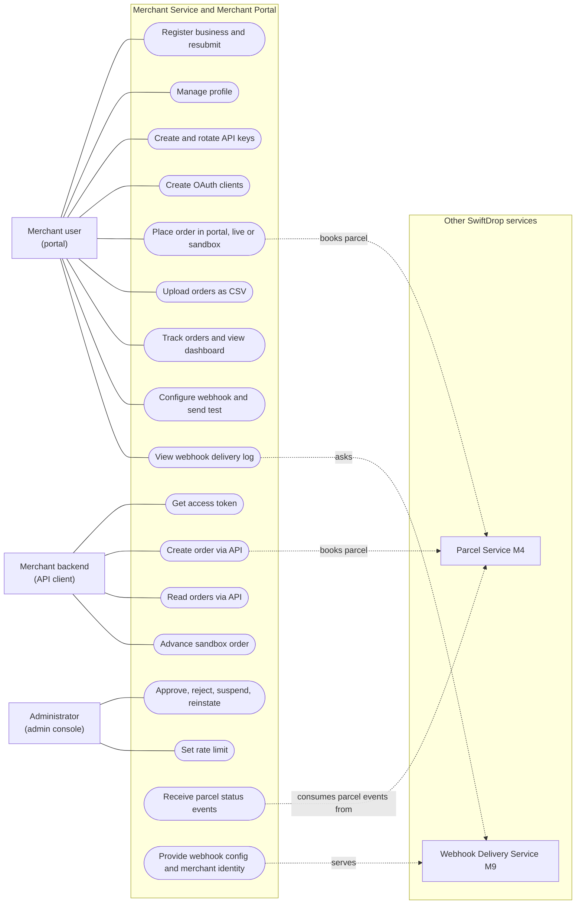
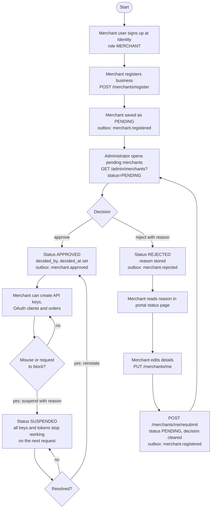
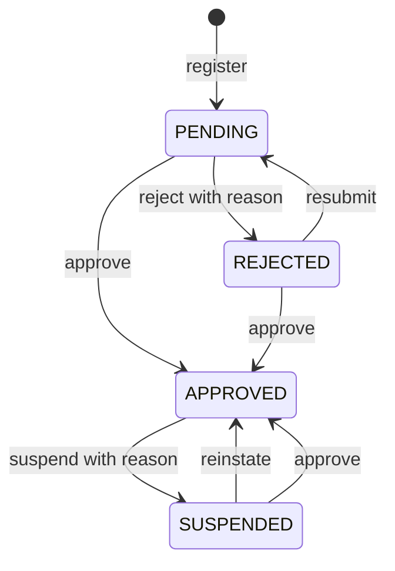
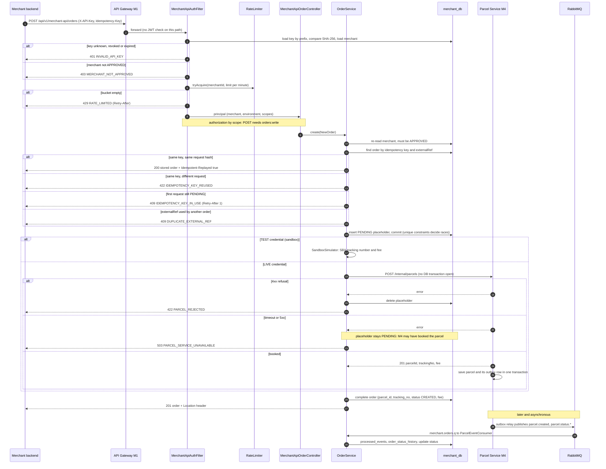
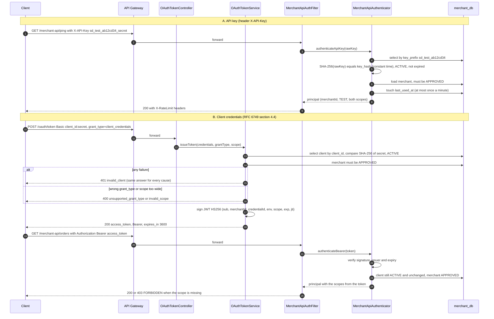
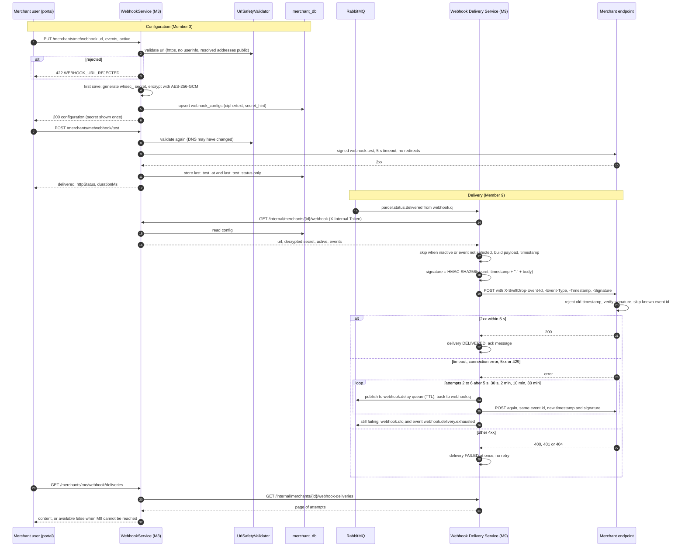
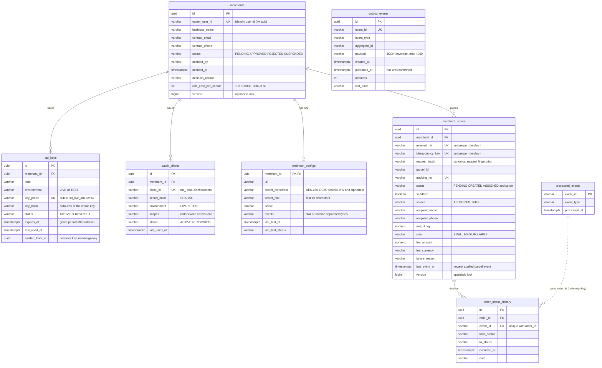
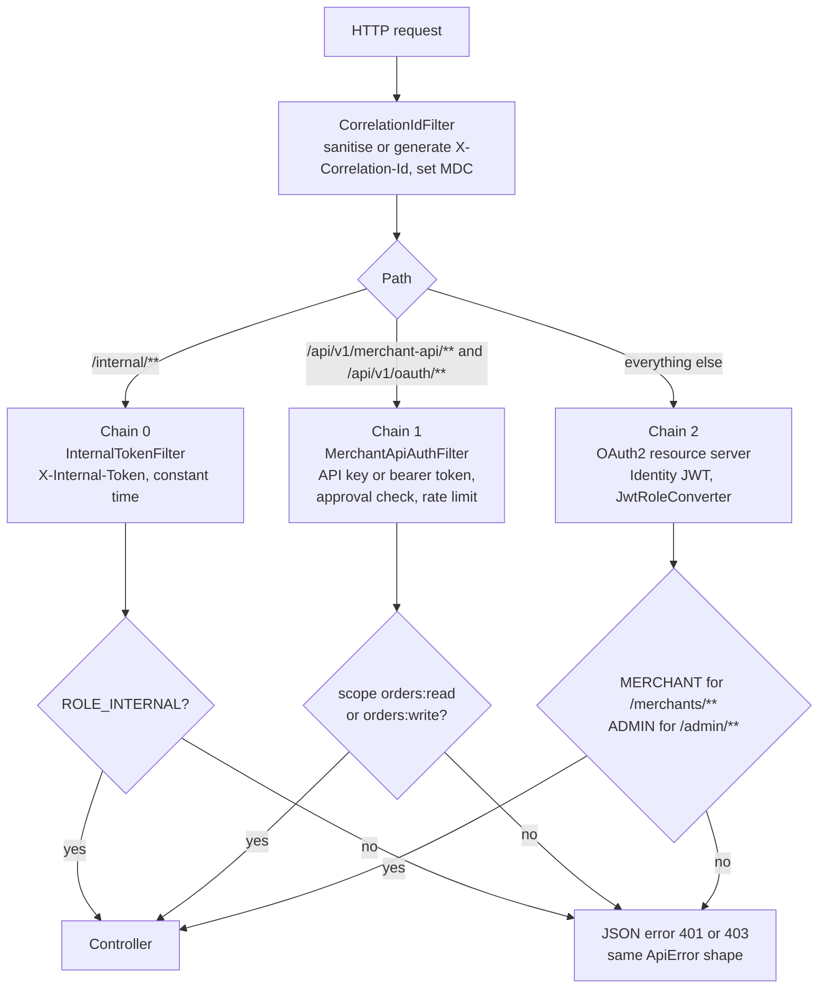

# Merchant Service and Merchant Portal: design notes (Member 3)

Design notes for the group design document, Member 3 part. They describe what is built (service in `services/merchant`, portal
in `frontend/projects/merchant-portal`), not what was planned. The binding specification is [`CONTRACT.md`](CONTRACT.md); how to run
and operate the service is in [`services/merchant/README.md`](../../services/merchant/README.md); the public API is described in
[`openapi.yaml`](../../services/merchant/src/main/resources/merchant-api/openapi.yaml).

## 1. Scope and responsibilities

Member 3 owns everything about the **merchant** as a customer of SwiftDrop:

* registration and the admin approval workflow, per-merchant rate limits;
* API keys (hashed, rotation with grace period, revocation) and OAuth 2.0 client-credentials clients;
* the public merchant API (create, get and list orders, ping), the sandbox, and bulk CSV upload for the portal;
* the merchant-side read model of parcel status, kept up to date from parcel events;
* webhook **configuration** (URL, event selection, encrypted secret), a signed test ping and the delivery-log view (delivery itself
  belongs to Member 9);
* the Merchant Portal (Angular): registration, dashboard, orders, API keys, webhook settings, API docs.

Neighbours: Identity (M2) issues the portal JWTs, the Parcel Service (M4) books live parcels, the Webhook Delivery Service (M9)
delivers webhooks and owns the event envelope, the gateway (M1) routes requests, the admin console (M10) uses the approval endpoints.

## 2. Merchant use case overview

Creating credentials and orders requires an approved merchant (the approval use case, section 3); the merchant API enforces it on every call. Portal users sign in with a JWT issued by the Identity Service (M2), which is not drawn.

## 3. Merchant approval

### 3.1 Activity diagram

### 3.2 States

The transition rules live in the `Merchant` entity (`approve`, `reject`, `suspend`, `reinstate`, `resubmit` call `requireStatus`),
so no caller can bypass them; an illegal transition is `409 INVALID_STATE`. Only `APPROVED` merchants pass the check in
`MerchantApiAuthenticator`, `CurrentMerchantProvider.requireApprovedMerchant()` and `OrderService`.

## 4. Order creation through the merchant API

The merchant service itself writes no outbox row for an order: its outbox carries only `merchant.*` events. The event that tells the
world about a new parcel (`parcel.created`) is written to the **Parcel Service's** outbox in the same transaction as the parcel;
the merchant service learns about status changes through its queue.

## 5. API key and OAuth client-credentials authentication

Every request re-reads the credential and the merchant. That makes revocation and suspension immediate, at the price of one or two
indexed lookups per call.

## 6. Webhook configuration and delivery

## 7. Data model (merchant side)

Source: `src/main/resources/db/migration/V1__init.sql` (PostgreSQL 16; the same script runs on H2 in the tests). Columns that only
repeat a pattern (pickup and drop-off address columns, the other audit timestamps) are left out of the picture.

`outbox_events` and `processed_events` have no foreign keys on purpose: the first is a queue of messages leaving the service, the second a
set of ids of messages that arrived. The unique constraints do the real work: `(merchant_id, idempotency_key)` and
`(merchant_id, external_ref)` decide concurrent duplicate orders, `(order_id, event_id)` stops a duplicate history row,
`processed_events.event_id` makes the consumer idempotent, `key_prefix` makes key lookup a single indexed read.

## 8. Security chains

## 9. Design decisions and patterns

### 9.1 Patterns applied

| Pattern | Where | Why it is there |
|---|---|---|
| **Strategy** (behind an interface) | `RateLimiter` with `InMemoryRateLimiter`; `ParcelClient` with `HttpParcelClient` (tests use a fake); `HostResolver` with `DnsHostResolver` | The algorithm can be replaced without touching callers: a Redis limiter for several replicas, a different parcel API, a fake DNS in tests |
| **Repository** and **Specification** | Spring Data repositories (`MerchantRepository`, `MerchantOrderRepository`, `ApiKeyRepository`, ...); `OrderSpecifications`, `MerchantSpecifications` | Persistence is hidden behind interfaces; the combinable list filters (status, text search, sandbox mode, date range) are built from small specifications that are always scoped to one merchant |
| **Transactional Outbox** | `OutboxService.enqueue` (`Propagation.MANDATORY`), `OutboxRelay`, table `outbox_events` | A merchant change and its event are committed together, so an event is neither lost when the broker is down nor sent for a rolled-back change |
| **Idempotent Consumer** | `ParcelEventHandler` with `ProcessedEventRepository.insertIfAbsent`; unique `(order_id, event_id)` | RabbitMQ delivers at least once; duplicates and redeliveries change nothing |
| **Idempotent API (request fingerprint)** | `RequestFingerprint`, `Idempotency-Key`, placeholder row in `OrderService` | A client may retry a create safely; the database unique constraints, not application locks, arbitrate concurrent duplicates |
| **Template Method** | `MerchantApiAuthFilter`, `InternalTokenFilter`, `CorrelationIdFilter` extend `OncePerRequestFilter` (`doFilterInternal`, `shouldNotFilter`); `GlobalExceptionHandler` extends `ResponseEntityExceptionHandler` and overrides its hooks | The framework fixes the skeleton (once per request, which exception maps where); the service fills in only the variable steps |
| **Adapter** | `HttpParcelClient` (assumed M4 HTTP contract to the `ParcelClient` port), `DeliveryLogClient` (M9), `MerchantApiAuthentication` (principal to Spring's `Authentication`), `JwtRoleConverter` (claims to authorities) | Foreign shapes stay in one class; the rest of the code speaks the service's own types |
| **Chain of Responsibility / Decorator-style filters** | `CorrelationIdFilter` then `MerchantApiAuthFilter` then the authorization filter; the retry interceptor around the AMQP listener (`OrderMessagingConfig.retryInterceptor`) | Each wrapper adds one concern (correlation id, authentication and rate limit headers, retries) around the next without changing it |
| **State** (rules next to the data) | `Merchant` transitions (`requireStatus`); `OrderStatus.nextInSandboxLifecycle`, `isTerminal` | Legal transitions are defined once, on the type that has the state |
| **Factory** | `ApiErrorFactory`, `KeyGenerator`, named constructors such as `Merchant.register`, `MerchantOrder.placeholder`, `OAuthException.invalidClient` | Creation rules (ids, timestamps, error shape) in one place |
| **Facade** | `OrderService.create` | Controllers (portal, API, bulk importer) call one method; idempotency, sandbox versus live and cleanup are not their concern |
| **Value objects** | Java records for every DTO, `Money`, `ApiError`, `RateLimitResult`; sealed interface `WebhookView` (`NotConfigured` or `Configured`) | Immutable, normalised in the compact constructor (trim, phone clean-up), logging-safe `toString` |

### 9.2 SOLID, with real classes

* **Single responsibility.** `OrderService` decides what to do, `OrderWriter` owns the short database transactions, `RequestFingerprint`
  hashes requests, `SandboxSimulator` makes up tracking numbers and fees, `HttpParcelClient` talks HTTP. `WebhookSigner` only signs and verifies;
  `UrlSafetyValidator` only judges URLs.
* **Open/closed.** `MerchantApiSecurityConfig` authorizes by HTTP method and scope, not by listing endpoints: a new `GET` under
  `/merchant-api/` is protected by `orders:read` with no configuration change. A new error is one `ErrorCode` constant with its status;
  `GlobalExceptionHandler` needs no change.
* **Liskov substitution.** Any `RateLimiter` or `ParcelClient` can stand in for another; every `ApiException` subclass is handled uniformly by the
  one handler through its status and code.
* **Interface segregation.** `ParcelClient` has a single method, `HostResolver` one, `RateLimiter` one; collaborators depend only on what they call.
* **Dependency inversion.** `OrderService` is constructed with `ParcelClient`, `MerchantService`, `Clock` and `OrderWriter`; no `new HttpClient()` in
  business code, and the `Clock` bean lets tests control time (token expiry, rate limit refill, key grace period).

### 9.3 Security decisions

| Decision | Reason |
|---|---|
| API keys are `sd_<env>_<id8>_<secret43>`; only the SHA-256 of the whole key is stored; the public prefix is the lookup key; shown once | A database leak yields no usable keys. The secret is 256 random bits, so a fast hash is adequate (no password-style stretching needed) and lookups stay cheap; hashes are compared with `MessageDigest.isEqual` |
| Separate filter chain for `/merchant-api` and `/oauth`, independent of Identity | Integrators use keys, not user sessions. A bug in one chain cannot weaken the other; the gateway must not apply user-JWT checks there |
| Credential and merchant are loaded on **every** request | Revoking a key, deleting a client or suspending a merchant takes effect at once; no cache to invalidate |
| One 401 message for every credential failure; `invalid_client` for every token failure, including a merchant that is not approved | The API cannot be used to learn which keys, clients or merchants exist |
| Rejected credentials do not consume the rate limit and get no rate-limit headers | Garbage requests cannot be used to exhaust a merchant's budget; headers are not an oracle |
| Token endpoint refuses parameters in the query string; client authentication before `grant_type` is looked at | Secrets must not reach access logs (RFC 6749 section 3.2); an unauthenticated caller learns nothing about supported grants |
| Access tokens are HS256 JWTs signed with `MERCHANT_TOKEN_SECRET`, validated only by this service, scopes inside the token, client re-checked on use | No JWKS or key distribution for a token that no other service accepts; revoking the client kills tokens already issued |
| Webhook secrets are encrypted (AES-256-GCM, random IV), not hashed | They must be recoverable to sign deliveries; GCM authenticates the ciphertext, the key lives in an environment variable |
| Webhook signature `HMAC-SHA256(secret, timestamp + "." + body)` and a 5-minute window | Proves origin and integrity, makes a replayed request detectable; the event id enables duplicate detection |
| Webhook URL checks: https only, no credentials, **resolved** addresses must be public, re-checked before each ping, no redirects, response body discarded, only fixed error phrases returned | Server-side request forgery protection; judging resolved addresses defeats numeric host tricks (`2130706433`, `0x7f.1`) |
| Errors never echo input; SQL, stack traces and upstream bodies are not exposed; 500 has a generic message with the correlation id | No information leak; support can still find the log entry |
| PII is masked or left out of logs (`PiiMasker`, custom `toString` on DTOs); a log-leak test runs the flows at DEBUG | Spring logs bodies at DEBUG; a mistaken log level must not leak personal data or secrets |
| Correlation ids are accepted only as 1 to 64 characters of `[A-Za-z0-9._:-]` | Prevents log injection and oversized values travelling into events |
| `@Profile("dev")` token endpoint; the HS256 decoder works only in the `dev` and `test` profiles | A leaked development secret cannot weaken a production deployment |
| `/internal/**` on its own chain with a constant-time token comparison; never routed through the gateway | Service-to-service secrets are not user credentials |
| Optimistic locking (`@Version`) on `merchants` and `merchant_orders`; CSV cells starting with `=`, `+`, `-`, `@` stored as they are and escaped on export | Lost updates become `409 OPTIMISTIC_LOCK`; spreadsheet injection is prevented where data leaves the system |
| TEST and LIVE credentials see disjoint order sets; sandbox orders publish no events and trigger no webhooks | An integration test can never touch real parcels or notify real customers |

### 9.4 Other design decisions

* **No database transaction around the parcel call.** The placeholder is committed first, then the HTTP call runs, then the row is completed.
  A slow Parcel Service cannot hold connections, and the unique constraints make concurrent duplicates safe. The price is a short-lived `PENDING` row
  (cleaned up after five minutes if the process dies in between).
* **Read model instead of calling M4 for reads.** Dashboards read `merchant_orders` and `order_status_history`, fed by events. Reads stay fast and survive
  an M4 outage; status can lag by the delivery time of the event.
* **Late events are recorded, not applied.** `last_event_at` guards the status: an event older than the last applied one goes into the history only.
* **Assumptions are isolated.** Everything guessed about M4, M9 and M2 sits in `HttpParcelClient`, `DeliveryLogClient`, `WebhookSigner`,
  `JwtDecoderConfig` and `JwtRoleConverter`, so a change of the real interface touches one class.

### 9.5 Trade-offs and known limitations

| Topic | Limitation | Possible improvement |
|---|---|---|
| Rate limiting | The token bucket is in memory per replica, so N replicas allow up to N times the limit | A Redis-backed `RateLimiter`; the interface already exists |
| Outbox relay | No row locking: several replicas can publish the same row twice, and delivery order across replicas is not guaranteed; polling adds up to about a second of latency | `select ... for update skip locked`, or a single relay replica |
| Booking | Exactly-once only if M4 honours its `Idempotency-Key`. The key is the placeholder's id, and an ambiguous failure keeps the placeholder, so the retry (same key, or same request and `externalRef`) completes that placeholder and M4 returns the original booking | Reconcile placeholders against M4 instead of trusting its de-duplication |
| Early events | A status event that arrives before the order is completed matches no order and is recorded as processed (a window of milliseconds) | Park unmatched events and retry them |
| Event inputs | The consumer needs `data.merchantId` (UUID) and `data.trackingNo` or `data.parcelId`. `parcel.assigned` and `parcel.cancelled` carry only a parcel id in the M9 catalogue, so they are matched by parcel id; the M9 example uses `MER-031` as merchant id, which is not a UUID | Agree the field and the id format with M4, Dispatch and M9 |
| Webhooks | Delivery log and delivery behaviour are as designed by M9; this service never saw the real M9. SSRF check has a small DNS-rebinding window | Pin the validated IP; apply the same checks in M9; egress rules |
| Authentication cost | Two or three indexed lookups on every merchant API call | A short-lived cache, accepting slower revocation |
| Tokens | No refresh tokens; HS256 shared secret known to this service only; one secret for all tokens (rotation invalidates them all) | Key id (`kid`) and a key ring |
| Database tests | The integration tests ran on H2 in PostgreSQL mode; locks and PostgreSQL specific SQL were not exercised on a real PostgreSQL, the broker test needs Docker | Run the suite in CI with Testcontainers PostgreSQL |
| Bulk upload | Sequential, so a down Parcel Service makes a large live file slow; rows are never skipped early | Asynchronous import job with progress |
| Dev conveniences | The production bundle of the portal still contains the unreachable dev-login code behind a build flag | File replacement in the build |

## 10. How it is tested (summary)

* JUnit 5, Mockito, MockMvc and AssertJ on H2 (PostgreSQL mode) with the real Flyway migration; no Docker needed; the whole application context is
  started for the API, authorization and workflow tests (merchant approval, API key validation, unapproved merchants blocked from creating orders).
* Event flow: relay against a mocked `RabbitTemplate` and the real outbox table, consumer against the real handler (duplicates, late events, poison
  messages, retry then dead-letter), plus a broker test with Testcontainers that is skipped without Docker.
* Concurrency tests: eight threads with the same idempotency key or `externalRef`, four threads delivering one event.
* Security tests: log-leak tests at DEBUG for secrets and personal data, internal endpoint authorization, dev endpoint absent outside the dev profile.
* `OpenApiParityTest` keeps `openapi.yaml` and the controllers in step. JaCoCo enforces at least 70% line coverage in `mvn verify` (about 98% at the last full run).
* Portal: Karma and Jasmine (services with `HttpTestingController`, guards, interceptor, secret-once dialog, one component test per page).
