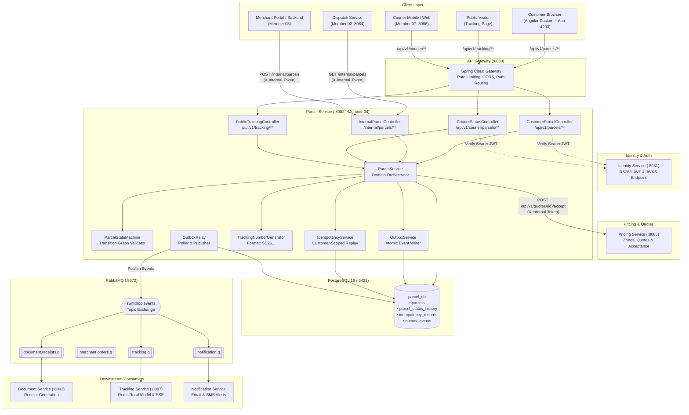
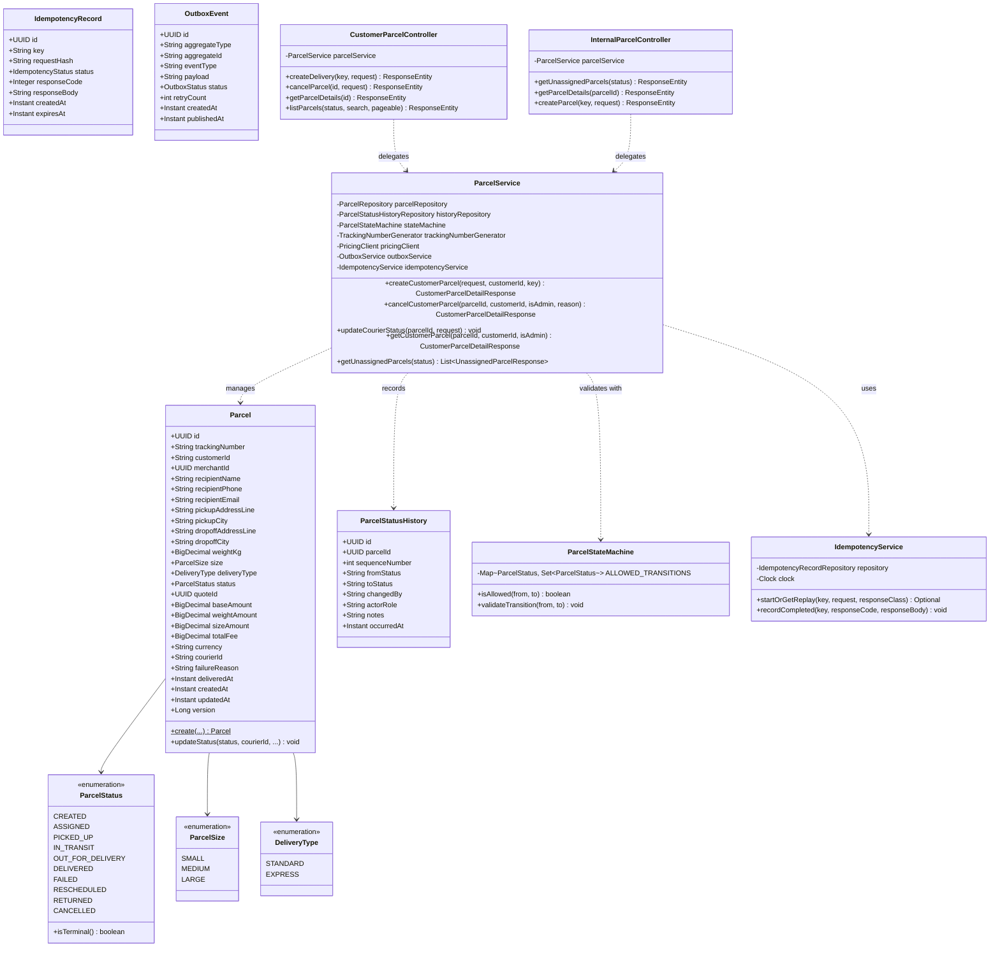
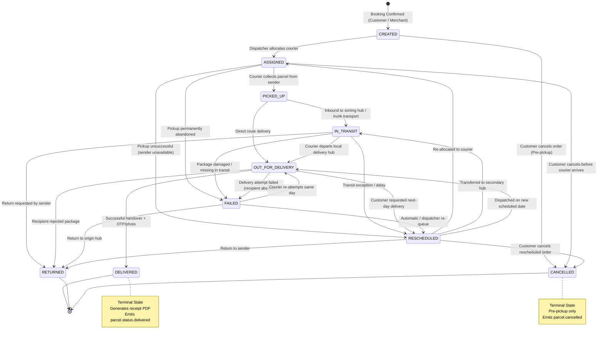
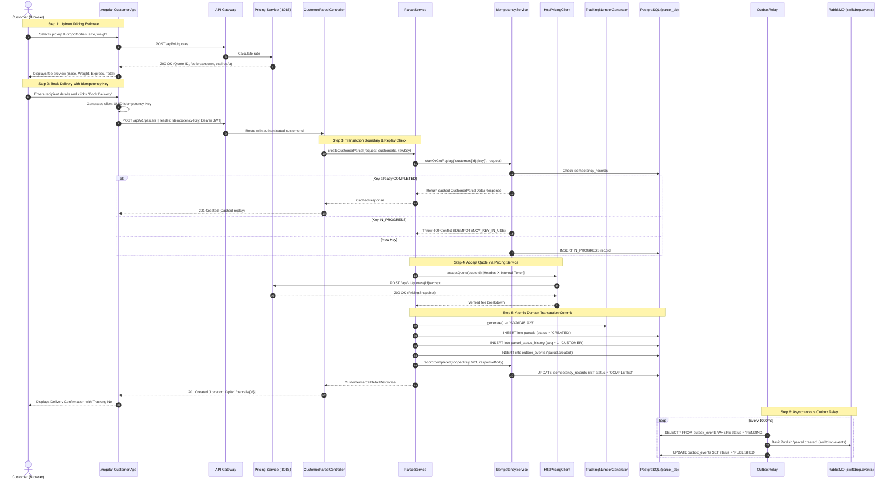
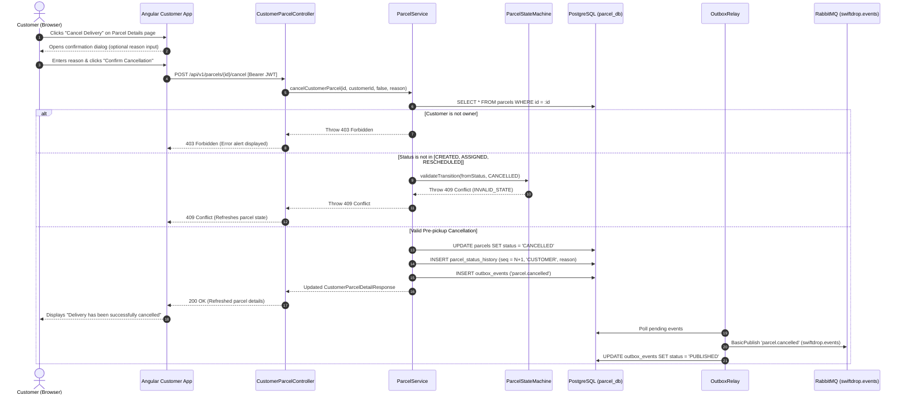

# Parcel Service & Customer Application: Design & Architecture (Member 04)

> **Owner:** Member 04  
> **Service:** `services/parcel`  
> **Frontend:** `frontend/projects/customer-app`  
> **Binding Contract:** [`CONTRACT.md`](CONTRACT.md)  
> **Related Specifications:** [`../events/catalogue.md`](../events/catalogue.md), [`../events/envelope.schema.json`](../events/envelope.schema.json)  

---

## 1. Scope & System Role

Member 04 owns the **Parcel Core Domain** and the **Customer Application**:
1. **Parcel Core Domain:** Parcel entity persistence, lifecycle state machine enforcement, immutable status history auditing, tracking number generation with collision retry, and transactional outbox event emission.
2. **Customer Delivery Booking:** Upfront rate estimation with Pricing Service, atomic quote acceptance, and customer-scoped idempotency replay.
3. **Dispatch Integration:** High-throughput `GET /internal/parcels?status=CREATED` endpoint allowing Dispatch Service (Member 02) to pull unassigned parcels.
4. **Customer Delivery Cancellation:** Secure, owner-validated pre-pickup cancellation with transition guards and outbox publication.
5. **Customer Frontend Application:** Modern Angular 20 SPA providing self-service delivery booking, live pricing calculation, parcel details, vertical audit timelines, public tracking, and receipt retrieval.

---

## 2. Microservice Architecture & Topology

---

## 3. Domain Model & Class Diagram

The Parcel Service domain architecture isolates controllers, business logic, state transitions, transaction boundary management, and persistence entities.

---

## 4. Lifecycle State Machine

The parcel lifecycle consists of 10 distinct statuses. The transition graph enforces business logic and prevents illegitimate skips or updates after reaching terminal states (`DELIVERED`, `RETURNED`, `CANCELLED`).

---

## 5. End-to-End Sequence Diagrams

### 5.1 Customer Upfront Pricing & Atomic Parcel Booking

This sequence illustrates the customer booking flow: estimating the quote, accepting it through Pricing Service, enforcing atomic database updates with customer-scoped idempotency, and emitting the outbox event.

---

### 5.2 Customer Delivery Cancellation

---

## 6. PostgreSQL Schema Design

The `parcel_db` schema adheres to strict data integrity rules, check constraints, foreign keys, and optimistic concurrency locking:

* `parcels`: Primary operational entity. Stores tracking number (unique), customer/merchant IDs, pickup/dropoff addresses, physical specs (weight, size, priority), accepted fee breakdown, courier assignment, failure reasons, and timestamps.
* `parcel_status_history`: Append-only audit trail. Sequence numbers are strictly incremented per parcel ID. Indexed on `parcel_id` and `sequence_number`.
* `idempotency_records`: Records hashed requests by scoped key (`customer:{id}:{key}` or `merchant:{key}`), request SHA-256 hash, execution status (`IN_PROGRESS`, `COMPLETED`), and serialized response body.
* `outbox_events`: Transactional outbox table. Stores `aggregate_id`, `event_type`, JSON payload, retry counts, and publication timestamps.

---

## 7. Testing & Quality Verification

Member 04 maintains 100% passing automated test suites across all backend and frontend layers:

1. **Parcel Service Backend:**
   * **Test Count:** **128 tests run, 0 failures, 0 errors, 0 skipped**.
   * **State Transition Coverage:** `ParcelStateMachineTest` exhaustively tests all valid combinations and invalid/terminal rejections (40 tests).
   * **Idempotency & Concurrency:** Verified atomic completion, scoped key collision prevention, and payload mismatch rejection.
   * **Integration Tests:** `ParcelEventFlowIntegrationTest` verifies transactional outbox persistence and relay formatting.
2. **Customer Frontend Application:**
   * **Test Count:** **80 tests run, 0 failures, 0 errors** in Chrome Headless.
   * **Components Verified:** `BookDeliveryPage`, `ParcelDetailsPage`, `DeliveryHistoryPage`, `TrackParcelPage`, `SignupPage`, `LoginPage`.
   * **Production Build:** Passes with initial bundle size of **300.14 kB**, well within the 1 MB budget.

---

## 8. Integration Status & Dependencies

* **Pricing Service (:8085 - Member 05):** Fully integrated for active zones fetching and synchronous quote acceptance via `HttpPricingClient`.
* **Identity Service (:8081 - Member 01):** Integrated for RS256 JWT bearer token verification and public keys (`/.well-known/jwks.json`).
* **Dispatch Service (:8084 - Member 02):** Implemented `GET /internal/parcels?status=CREATED`. Dispatch Service needs to include `X-Internal-Token: dev-internal-token` in its `ParcelClient` to pull live parcels.
* **Courier Service (:8086 - Member 07):** Updates parcel delivery statuses and proof of delivery via `/api/v1/courier/parcels/{parcelId}/status`.
* **Document Service (:8092 - Member 05):** Client proxy route `/api/v1/receipts` configured. Live testing requires starting the Document Service container.
