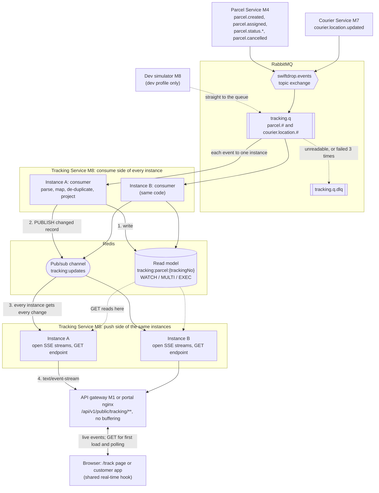
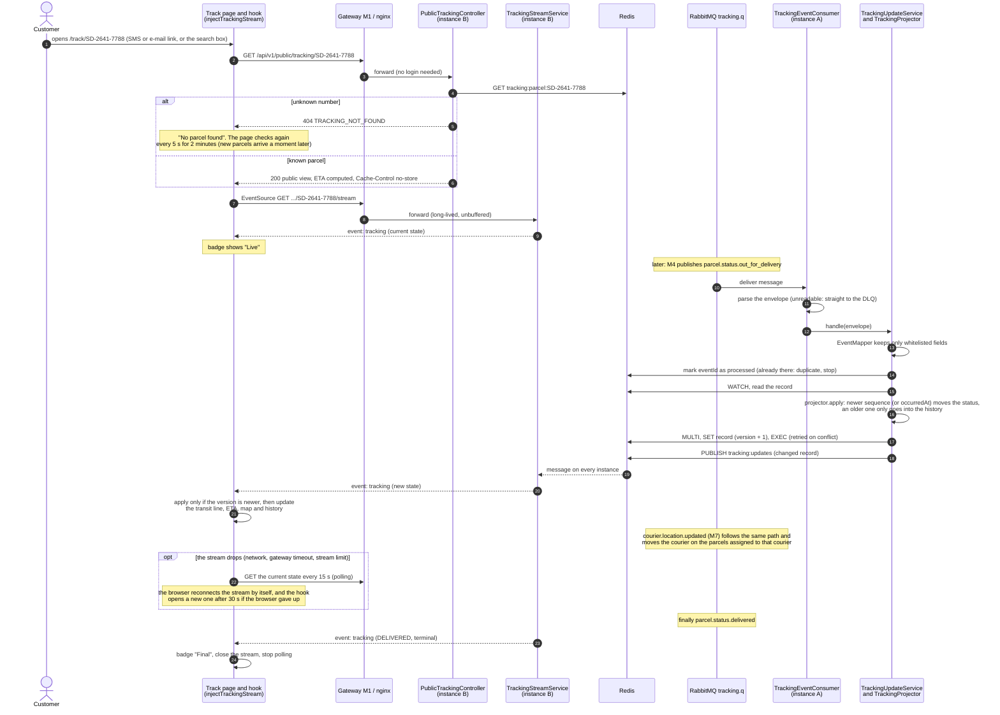
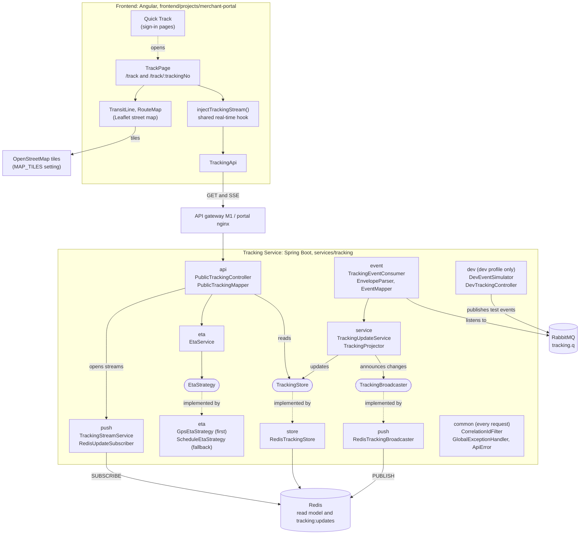

# Tracking Service and Public Tracking Page: design notes (Member 8)

Design notes for the group design document, Member 8 part. They describe what is built (service in `services/tracking`,
page and hook in `frontend/projects/merchant-portal`), not what was planned. The binding specification is
[`CONTRACT.md`](CONTRACT.md); how to run the service is in [`services/tracking/README.md`](../../services/tracking/README.md).

## 1. Scope and responsibilities

Member 8 owns "where is my parcel right now?" for anyone holding a tracking number:

* an **event consumer** that builds a per-parcel **read model in Redis** from parcel and courier events;
* **live push** to browsers with server-sent events (SSE), and a **polling fallback** with the same data;
* **public tracking by number**, without login, that can only show non-personal data;
* an **ETA estimate** (live GPS when there is a fresh courier position, otherwise the stage schedule);
* the **public tracking page** (mobile first: timeline, live street map, history) and the **real-time hook** shared with
  the customer app.

Neighbours: the Parcel Service (M4) and the Courier Service (M7) publish the events, the event backbone (M9) owns the
exchange and the event catalogue, the gateway (M1) routes public traffic, the merchant and notification services link
to `/track/<trackingNo>`.

## 2. Real-time architecture

How it works:

* **Events in.** Each event reaches `tracking.q` once. When several instances run, they compete for messages, so each
  event is applied by exactly one of them. Messages that cannot be read, or that still fail after three attempts with
  backoff, are dead-lettered to `tracking.q.dlq` and can be replayed from the RabbitMQ UI.
* **Read model.** The instance that takes the event updates the parcel's record in Redis. Concurrent updates to the same
  parcel are safe: the write is retried if another instance changed the record in between (optimistic locking with
  `WATCH`/`MULTI`/`EXEC`). The record holds only the public view of the parcel: no names, phone numbers or addresses.
* **Fan-out.** A browser's stream can be open on a different instance than the one that applied the event. So every
  changed record is published on the Redis channel `tracking:updates`. Every instance listens to it and pushes the record
  to its own open streams for that parcel. This is what lets the service scale horizontally.
* **Reads.** `GET /api/v1/public/tracking/{trackingNo}` and the first event of every stream are served from Redis only.
  A burst of tracking traffic never reaches the Parcel Service or its database, and tracking keeps working while the
  Parcel Service is down.
* **Push.** SSE: one long HTTP response per open page, `event: tracking` per change, a keep-alive comment every 20 s,
  `retry: 3000` so the browser reconnects by itself. Limits: 5,000 streams per instance and 50 per parcel. Beyond that,
  the answer is `503 STREAM_LIMIT_REACHED` and the page polls instead.

## 3. Tracking sequence: from an event to the open page

## 4. Components

Each box is a package (component) with its main classes, and arrows point to what it depends on; rounded boxes are interfaces. In the tests, `TrackingStore`
and `TrackingBroadcaster` are replaced by in-memory versions (`InMemoryTrackingStore`, `DirectBroadcaster`), so most
tests need neither Redis nor RabbitMQ. `common` (correlation ids, standard errors) is used by every request.

## 5. Design decisions and patterns

### 5.1 Patterns applied

| Pattern | Where | Why it is there |
|---|---|---|
| **Event-driven read model** (CQRS read side) | Redis records built only from events; `PublicTrackingController` reads nothing else | Public reads are fast, isolated from the Parcel database, and keep working during an M4 outage |
| **Idempotent consumer** | `TrackingStore.markProcessed(eventId)` (kept 7 days), undone if applying fails so the retry can apply it | RabbitMQ delivers at least once; a redelivered event changes nothing |
| **Optimistic locking** | `RedisTrackingStore.compute`: `WATCH`, read, `MULTI`/`SET`/`EXEC`, retry | Two instances updating the same parcel never lose an update, without locks |
| **Publish/subscribe (Observer)** | `RedisTrackingBroadcaster` → channel `tracking:updates` → `RedisUpdateSubscriber` on every instance → `TrackingStreamService` | Any instance can serve any stream, whichever instance applied the event |
| **Strategy** | `EtaStrategy` with `GpsEtaStrategy` and `ScheduleEtaStrategy`, tried in order by `EtaService` | A better estimator is one new class; nothing else changes |
| **Ports and adapters** | `TrackingStore`, `TrackingBroadcaster` interfaces with Redis adapters | Storage and fan-out can be replaced; tests run in memory |
| **Anti-corruption layer** | `EventMapper` is the only class that knows other members' event shapes, and it copies a fixed whitelist of fields | A change in an event touches one class; personal data never enters the service |
| **Template Method** | `CorrelationIdFilter` (`OncePerRequestFilter`), `GlobalExceptionHandler` (`ResponseEntityExceptionHandler`) | The framework fixes the flow; the service fills in only its steps |
| **Lifecycle hook** | `TrackingStreamService` is a `SmartLifecycle`: closes its streams on shutdown | During a rolling deploy, browsers reconnect to another instance |
| **Facade (frontend)** | `injectTrackingStream()` hides HTTP, SSE, polling, retries and clean-up behind signals | The page and the customer app use the same five-line API |

### 5.2 Other design decisions

* **SSE rather than WebSocket.** Updates only flow from server to browser. SSE is plain HTTP through the gateway and
  nginx, needs no extra protocol, and the browser reconnects by itself. The cost is one open connection per page, which
  is bounded by the stream limits.
* **Privacy by construction.** The service never stores personal data, so the public endpoint cannot leak it. City
  coordinates are rounded to about 1 km, courier positions to about 100 m, and the courier is hidden when the position is
  older than 15 minutes or the parcel is not on its way.
* **Ordering.** A per-parcel `sequence` decides which event is newer; without it, `occurredAt` does. A late event is added
  to the history but never moves the status backwards.
* **Always something to show.** If the stream is down, the page polls every 15 s. If a number is not known yet, it
  checks again every 5 s for 2 minutes. If there is no fresh GPS position, the ETA comes from the stage schedule.
* **Map.** Leaflet with OpenStreetMap tiles, set through the `MAP_TILES` token. Leaflet is only loaded with the `/track`
  page, and the portal's content security policy allows only that tile host.

### 5.3 Trade-offs and known limitations

| Topic | Limitation | Possible improvement |
|---|---|---|
| Event content | The M9 catalogue's `parcel.created` carries ids only, so there is no route or map until M4 adds town names and coordinates | Agree the extra fields (CONTRACT.md section 6), or look the towns up from the Parcel Service |
| Courier position | Needs `courier.location.updated` from M7, which is not in the catalogue yet; positions follow `parcel.assigned` links | Agree the event; include `trackingNo` when a courier carries one parcel |
| Gateway | The gateway has no public stream route without a circuit breaker yet, so through the gateway the page falls back to polling | One route in the gateway (CONTRACT.md section 6) |
| Redis | Single point of failure for tracking: when it is down, `503 SERVICE_UNAVAILABLE`. The read model can only be rebuilt by replaying events | Redis replication; a rebuild job from the Parcel Service |
| Connections | Each open page holds a connection and a little memory on one instance | Raise the limits, or add instances behind the gateway |
| Map tiles | The OpenStreetMap tile servers are for light use | Own tile server or a commercial provider for production |

## 6. How it is tested (summary)

* JUnit 5, MockMvc and AssertJ; most tests run against in-memory replacements for Redis and the broker, so they need no
  Docker. JaCoCo enforces at least 70% line coverage in `mvn verify` (about 89% at the last full run).
* **Event to push** (work-split test): `EventToPushIntegrationTest` starts the real HTTP server, opens a real SSE
  connection, hands events to the consumer exactly as the broker would, and checks they reach the stream and the polling
  endpoint. `EventToPushContainersTest` does the same with real RabbitMQ and Redis (Testcontainers; skipped without
  Docker, runs in CI).
* **Public endpoint leaks no personal data** (work-split test): `PublicTrackingPrivacyTest` sends events full of names,
  phone numbers, e-mail and street addresses, then checks the JSON values, the field names, the SSE stream and the stored
  record.
* Unit tests for parsing, mapping, ordering, duplicates, retries and dead-lettering, the ETA strategies, stream limits
  and heartbeats, and the dev simulator.
* Frontend: Karma and Jasmine for the hook (live, polling fallback, reconnect, not found, finished), the page, the map,
  the transit line and Quick Track.
