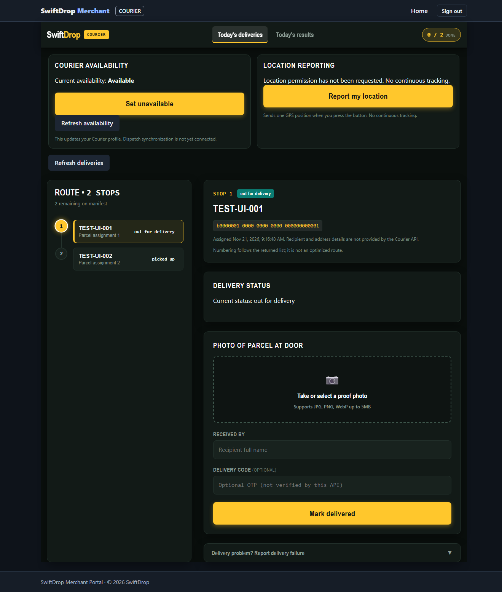
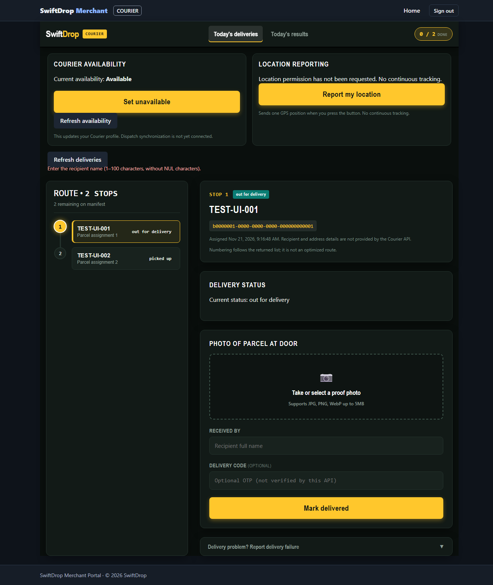
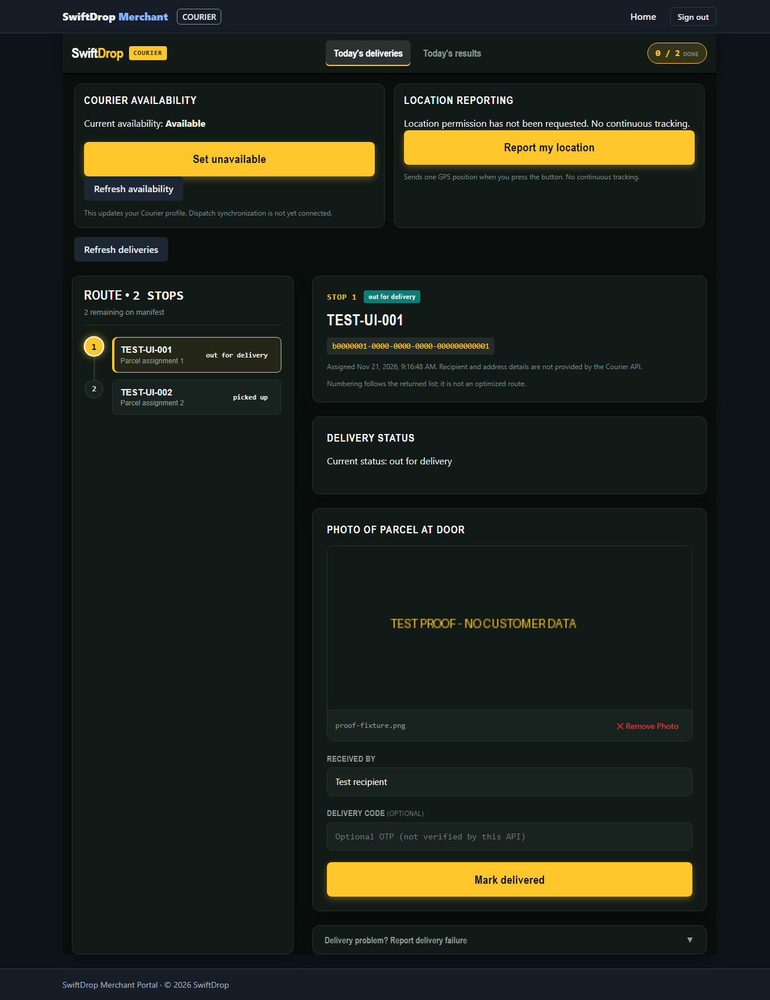
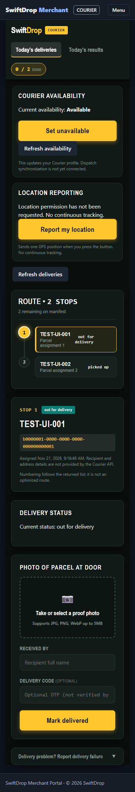
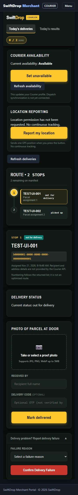
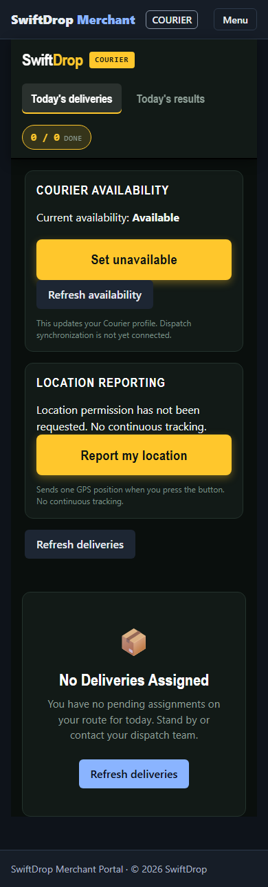
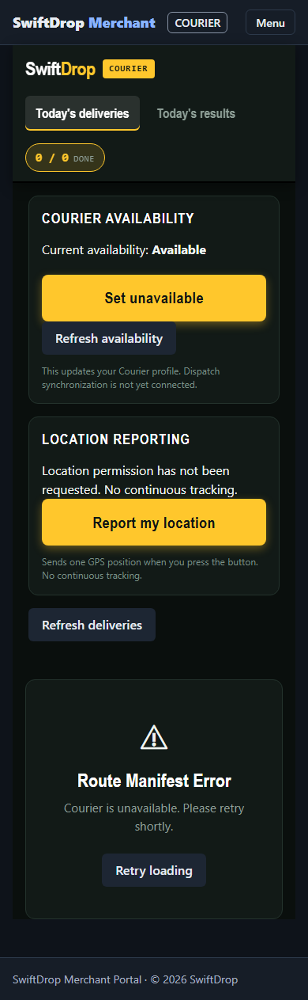

# M7 finalization review — 2026-11-21

**Classification: Functionally complete with documented external integration limitations.**
The M7-owned implementation work identified in this review is complete and freshly tested.
This is not a claim of live cross-service verification or authorization for Git delivery.
No staging, commit, push, PR, merge, branch switch, stash operation or cleanup was performed.

## Changes made during this finalization

1. Supported same-owner FAILED -> OUT_FOR_DELIVERY retry after authoritative M4 success:
   CourierAssignment.updateStatus clears the current completion timestamp when reopened;
   DeliveryService restores the local active count once. Duplicate OUT_FOR_DELIVERY does not
   increment again; eventual completion decrements once. Assignment identity/history and latest
   failure context are retained. Rejected or uncertain M4 calls leave local state unchanged.
   This does not synchronize M6 workload or create an immutable M7 attempt ledger.
2. Production JwtDecoderConfig now requires JWKS, accepts RS256, and checks token time and
   configured issuer, default swiftdrop-identity. Explicit dev/test HMAC support remains.
   AppProperties preserves its previous constructor while binding jwt-issuer.
3. Real production-bundle screenshots exposed white availability/GPS cards with inherited pale
   text. Three Courier CSS declarations now use existing Board/Border/Mist tokens. No redesign.
4. Added a Java 21 non-root Dockerfile and narrowly scoped .dockerignore; container build is
   **not tested**. Added deployment/runbook documentation and clarified existing README,
   proof-storage and GPS documentation. Shared deployment files remain unchanged.
5. Added focused regression/security tests and the documentation/evidence in this review.

Stage 4.2 ParcelClient PATCH transport, three-second timeouts, internal/correlation headers,
and M4 204 handling remain intact. Stage 4.4 decoding, transactional deduplication,
stale-event protection, retry/DLQ behavior and existing authorization/proof rules remain intact.
No dependencies, coverage thresholds or assertions were weakened.

## Fresh verification

| Check | Actual result | Scope and limits |
|---|---|---|
| New focused DeliveryServiceTest / JwtDecoderConfigTest | 38 passed | 31 service cases, 7 JWT cases; includes retry failure preservation and real local JWKS/signed-token fixtures |
| Full Courier Maven verify | 250 tests, 0 failures, 0 errors, 0 skipped | Existing full suite, with bounded JVM heaps and context cache; not a live deployed system |
| JaCoCo line coverage | 93.82%; existing 70% gate passed | ParcelClient 88.55%; DeliveryService 95.11%; configuration remains excluded by existing coverage configuration |
| Full Merchant Angular tests, after final CSS change | 718 passed; exit 0 | ChromeHeadless, complete Merchant suite |
| Merchant production build | Passed; exit 0 | Fresh build after final CSS change |
| Admin production build | Passed; exit 0 | Same successful npm run build |
| Actual production-bundle UI rendering | Seven views inspected | Isolated local fixture, desktop and 390px mobile; no actual backend/authentication success |
| Live Gateway/Courier/M4/PostgreSQL/MinIO/RabbitMQ/M8 | Not verified | Services unavailable; Docker stopped, engine pipe absent, memory pressure |
| Docker image/container | Not verified | Dockerfile source review only |

Commands used: from services/courier, mvn -q -Dspring.test.context.cache.maxSize=1 verify;
focused Maven selection DeliveryServiceTest,JwtDecoderConfigTest. From frontend, full Merchant
ng test with watch disabled/ChromeHeadless and npm run build (Merchant and Admin).
Evidence logs: Courier target/remaining-finalization-20261121-cb85d97b/verify.log and focused-new.log;
frontend .angular/remaining-finalization-20261121-tests-final.log and
remaining-finalization-20261121-builds-final.log. These ignored artifacts are not contribution files.
Tests were not rerun merely for subsequent documentation-only changes.

## Verified cross-service behavior and decisions

| Area | Actual source behavior | Safe M7 behavior / external decision |
|---|---|---|
| Assignment producer | M6 AssignmentService writes its assignment/workload/outbox; parcel.assigned and parcel.reassigned producer dispatch-service, version 1, eventId, occurredAt, aggregateId, correlationId, data and legacy payload | M7 accepts object or exactly one JSON-string wrapper; validates fields, uses persisted current-owner cursor/history and transactional event-ID/logical dedup |
| Parcel synchronization | M6 ParcelClient reads unassigned/details; no implemented Parcel assignment PATCH call in that flow. M4 separately validates its assigned courier | M4/M6 must establish which operation updates Parcel assignment consistently with Dispatch and handles partial failure. M7 cannot invent this synchronization |
| Reassignment/history | M7 closes prior active ownership and retains history, ignores strictly older events, rejects contradictory equal-time ownership | Previous courier is blocked; no invented ordering for ties/missing prerequisites. Invalid/unverifiable history fails closed and may require DLQ investigation |
| Missed-event recovery | No agreed M7 catch-up API; M4 internal lookup does not expose authoritative current assignment/status; M6 assignment read is dispatcher/admin protected | M6/M9 must supply verified history/replay using original IDs/timestamps and prerequisites. Do not borrow admin credentials or synthesize ownership |
| Availability | M6 CourierAvailabilityConsumer.handleCourierAvailabilityChanged defaults missing activeDeliveries to 0 and overwrites workload; lastAssignedAt guard is not general availability ordering/dedup | M7 API updates its own profile only; no availability publisher enabled. M6 must define patch-only availability or authoritative workload ownership plus ordering/dedup before publication |
| Failed attempt | M4 supports FAILED -> OUT_FOR_DELIVERY, RESCHEDULED, RETURNED; retry can retain same assigned courier | M7 local retry correction only after M4 success, covered by new tests. M6 global workload/terminal accounting still requires agreement |
| Idempotency | Optional M4 key: matching completed request replays 204; IN_PROGRESS returns 409; completed key with different payload returns 422. REQUIRES_NEW reservation can survive rejection; expiresAt metadata has no enforcement/recovery | No Idempotency-Key added. M7 lacks durable logical operation identity/stable proof reference/recovery. No automatic status-mutation retries. Investigate uncertain outcome before user retries; local refresh does not prove M4 outcome |
| Status contract | Real internal PATCH, existing request fields/internal token/correlation; M4 owns assignment and state validation, success is 204 with no JSON | Existing M7 error mapping preserves 409/422 meaning, ownership/state failures and uncertain timeouts; no simulated success. Transport unchanged |
| Messaging | Existing durable Courier queue/DLQ; bounded transient retry, permanent rejection separated; M7 three attempts then reject, no infinite requeue | At-least-once concerns remain; transactional dedup does not mean end-to-end exactly once. M9 owns broker/DLQ operational replay |
| GPS | M7 JSON-object version-1 courier.location.updated with courierId, lat, lng, recordedAt; persistent, mandatory, publisher-confirmed | M8 courier.location.# subscription is source-compatible; M8 rounds positions to three decimals and projects eligible parcels. ACK does not prove consumer processing; live route unverified |
| Identity/Gateway | M2 issuer swiftdrop-identity, RS256/JWKS; M1 Courier route allows COURIER/ADMIN and forwards existing API path | New nonlocal issuer/JWKS validation aligns M7; real authenticated Gateway request remains deployment verification |

M7 source inspected includes DeliveryService, CourierAssignment, ParcelClient, assignment consumer/
decoder/projection, repositories/migrations, storage adapters and validation, controllers/security,
GPS publisher and all dedicated Courier PWA files. External inspection covered committed/imported
M4 status/idempotency/state-machine source, M6 assignment/outbox/availability, M8 location consumer,
M9 catalogue/schema/broker definitions, M1 routes and M2 token configuration. No other member's
implementation was changed to obtain passing results.

## Deployment blockers and repeatable verification

See [DEPLOYMENT.md](DEPLOYMENT.md) for the exact proposed M1 Compose block, environment keys,
database/queue configuration, secret matching, host/container ports and real-token runbook.
Courier host port 8086 and container port 8080 must not collide with Gateway 8080.
The existing initializer provisions courier_db/courier_svc only on initial database-volume creation.
M7 INTERNAL_API_TOKEN must equal M4 SWIFTDROP_SECURITY_INTERNAL_TOKEN; defaults differ.
Real deployment requires matching JWKS/issuer, private storage credentials, and mock fallback disabled.

Shared Compose has no Courier, Parcel or MinIO service blocks. No shared file was edited.
Production Merchant nginx additionally needs owner-reviewed changes:
* API_UPSTREAM currently defaults to Merchant; Courier needs Gateway routing.
* client_max_body_size 2m is below the 5 MiB image / 6 MiB multipart envelope allowance.
* camera=() / geolocation=() must permit self where required, with HTTPS/user permission.
* img-src must include blob: for local image preview, without relaxing script policies.

MinIO/S3 adapter remains private/key-only; filesystem remains a local option.
Remote MinIO requires a trusted HTTPS endpoint with current adapter policy; no public URL or
database image data is introduced. No actual MinIO or container integration succeeded in this stage.
Docker/real services were not started on the unhealthy environment. The runbook explicitly
requires safe test data, real M2 login, evidence of the actual M4 204, and independent M8 observation.

## Existing diagrams: inspected, not redrawn

Reference: 11_Ryzera.pdf, physical pages 42, 48 and 54 (figures 12, 18 and 24).
The shared report is unchanged; the following are exact required corrections for its owner.

| Diagram | Corrections to reflect implementation |
|---|---|
| Courier use case, page 42, figure 12 | Replace/annotate Verify recipient OTP: optional OTP is accepted, not verified by current M4 path. GPS is explicit one-position reporting, not continuous tracking. Availability is local profile only |
| Status-to-notification sequence, page 48, figure 18 | Step 3 permits COURIER/ADMIN; step 4 derives subject from JWT, not client userId. Step 8 checks current assignment/history. Steps 12–13 validate upload or parcel-specific existing storage key, not a prerequisite proof row. Missing-proof branch 14–15 is M7 400, not 422. M4 step 22 is 204 empty, while M7 response to PWA remains 200 DTO. Step 23 records projection/proof; immutable status history is M4-owned. Add rejection/timeout branch without false success or unsupported idempotency promise |
| Delivery attempt activity, page 54, figure 24 | Failure UI submits supported enum, no invented free-text note. RESCHEDULED/RETURNED/dispatcher synchronization is not connected by an agreed M6 operation. Same-owner FAILED retry is supported. Optional OTP is not verification; adapter can be filesystem or private S3, not a claim of live MinIO |

Work split M7 requirements and page 5 of SwiftDrop UI Design (desktop).pdf were checked.
No new diagram/report replacement was created. Design documentation not present in the references
directory was not invented or treated as inspected.

## PWA evidence and seven-step review

Screenshots below use the freshly built real production bundle with **explicit synthetic local
API fixtures**, not real authentication/backend/storage. No customer addresses, recipients,
weights or ETAs were fabricated as backend data. Fixture proof says TEST PROOF; recipient input
is deliberate test input. Existing user browser profiles/tabs were not used.
A local file was selected and its actual blob preview loaded; no proof/status request was
submitted to a real service. Screenshots are intentional documentation assets, not live-test proof.

1. Desktop route board: actual task-list/status presentation, local availability notice and
   user-triggered GPS controls. Existing six Route Board colors and font-family declarations
   retained; fonts remain device-dependent because they are not newly bundled.
   
2. Delivered validation: absent proof/recipient produces visible error and no status mutation.
   
3. Real local file preview: file input loads the selected image via blob URL before submission;
   recipient and optional OTP fields remain available; no object URL is fabricated.
   
4. Mobile task board: 390px width, readable controls and wrapped identifiers; observed scrollWidth
   390, no horizontal overflow. Numbering follows returned tasks, not route optimization.
   
5. Failure form: supported enum selection and explicit submission; no unsupported notes contract.
   
6. Empty response: honest no-assignment state and refresh action.
   
7. Failed load: useful error and retry, without mock success.
   

Overall UI health: usable with the existing design after the small contrast correction.
Page-5 task/actions/proof/failure intent is retained while the approved dark Route Board identity
is preserved. Tests cover loading, auth/API errors, duplicate submissions, status/failure/upload/
availability/GPS behavior; screenshots cover selected rendered states, not every async branch.
Long mobile pages require vertical scrolling. Full WCAG certification, physical camera capture,
real GPS permissions, actual font installation and nginx-delivered production policies were not
established by this fixture review.

## Remaining external work, in dependency order

1. M4/M6: establish authoritative assignment update and reliable reconciliation/replay, including
   partial failure, historical prerequisites and reassignment. M7 remains fail-closed.
2. M6/M9: agree availability versus workload ownership, required fields, ordering/dedup and terminal/
   retry workload accounting. Until then M7 does not publish potentially corrupting snapshots.
3. M1/frontend owner: provision reviewed Courier/Parcel/private storage deployment; match secrets,
   issuer/JWKS/database/broker, correct production proxy/upload/permission/CSP configuration.
4. On a healthy environment run DEPLOYMENT.md real-token end-to-end demonstration: status
   update through Gateway to actual M4 204, ownership rejection, proof storage and GPS/M8.
5. M4: define stuck reservation expiry/recovery; only then design durable M7 operation identity/
   stable payload/proof and retry semantics if cross-request idempotency is required.
6. Shared report owner: apply diagram annotations listed above. No shared report edit authorized.

No remaining safe M7-only code gap identified by this review warrants inventing contracts.
The user-required live demonstration remains unverified until these environment/contract
dependencies are satisfied. Git delivery is a separate instruction.

## Contribution ownership and exclusions

The baseline contained 104 dedicated M7 source/documentation files already untracked.
They are preserved; changed versus unchanged classification and every path appear below.
[M7_COMMIT_FILES.txt](M7_COMMIT_FILES.txt) is an exact proposed future list, not a staging operation.
It includes dedicated Courier backend/PWA source plus two previously approved, inspected Courier-only
shared routing changes: app.routes.ts and proxy.conf.json. Those two files were not changed here.

Explicit exclusions:
* All 83 imported services/parcel/ files, source commit fb5e7d63bdb5758e566aa760acdfbe413078ceb8:
  M4 reference source, never part of the proposed M7 contribution.
* frontend/angular.json and frontend/projects/merchant-portal/karma.conf.js: shared test infrastructure,
  ownership ambiguous, left unchanged and excluded pending owner agreement.
* frontend/projects/merchant-portal/src/app/features/welcome/welcome.page.html: pre-existing shared
  welcome-link change, excluded because ownership is ambiguous.
* All ignored target/, .angular/, dist/, node_modules/, JVM crash/replay logs, local environment/
  secret files and backup directories. The seven docs/ui PNGs are intentional synthetic evidence.
* No other member's service or shared deployment/configuration file is proposed.

The proposed list includes existing M7 tests and prior hardening, not just this finalization's
changes. Do not use git add . or include services/parcel/ to stage this proposal.
Development-only test secrets/fixtures are not production credentials; no real credentials or
customer data were introduced. Production secret values are placeholders/environment references.

### New finalization files (13)

* services/courier/.dockerignore
* services/courier/DEPLOYMENT.md
* services/courier/Dockerfile
* services/courier/FINALIZATION_REVIEW.md
* services/courier/M7_COMMIT_FILES.txt
* services/courier/docs/ui/01-desktop-route-board.png
* services/courier/docs/ui/02-proof-validation.png
* services/courier/docs/ui/03-proof-preview.png
* services/courier/docs/ui/04-mobile-route-board.png
* services/courier/docs/ui/05-mobile-failure-form.png
* services/courier/docs/ui/06-mobile-empty.png
* services/courier/docs/ui/07-mobile-error.png
* services/courier/src/test/java/lk/swiftdrop/courier/config/JwtDecoderConfigTest.java

### Existing M7 files changed in finalization (10)

* frontend/projects/merchant-portal/src/app/features/courier/courier-pwa.page.css
* services/courier/GPS_REPORTING.md
* services/courier/PROOF_STORAGE.md
* services/courier/README.md
* services/courier/src/main/java/lk/swiftdrop/courier/config/AppProperties.java
* services/courier/src/main/java/lk/swiftdrop/courier/config/JwtDecoderConfig.java
* services/courier/src/main/java/lk/swiftdrop/courier/domain/CourierAssignment.java
* services/courier/src/main/java/lk/swiftdrop/courier/service/DeliveryService.java
* services/courier/src/main/resources/application.yml
* services/courier/src/test/java/lk/swiftdrop/courier/service/DeliveryServiceTest.java

### Every pre-existing dedicated M7 file (104)

| Path | This stage |
|---|---|
| frontend/projects/merchant-portal/src/app/features/courier/courier-pwa.page.css | Changed as described above |
| frontend/projects/merchant-portal/src/app/features/courier/courier-pwa.page.html | Preserved unchanged |
| frontend/projects/merchant-portal/src/app/features/courier/courier-pwa.page.spec.ts | Preserved unchanged |
| frontend/projects/merchant-portal/src/app/features/courier/courier-pwa.page.ts | Preserved unchanged |
| frontend/projects/merchant-portal/src/app/features/courier/courier-route.spec.ts | Preserved unchanged |
| frontend/projects/merchant-portal/src/app/features/courier/courier.models.ts | Preserved unchanged |
| frontend/projects/merchant-portal/src/app/features/courier/courier.service.ts | Preserved unchanged |
| services/courier/GPS_REPORTING.md | Changed as described above |
| services/courier/PROOF_STORAGE.md | Changed as described above |
| services/courier/README.md | Changed as described above |
| services/courier/pom.xml | Preserved unchanged |
| services/courier/src/main/java/lk/swiftdrop/courier/CourierServiceApplication.java | Preserved unchanged |
| services/courier/src/main/java/lk/swiftdrop/courier/client/ParcelClient.java | Preserved unchanged |
| services/courier/src/main/java/lk/swiftdrop/courier/client/ParcelStatusUpdateRequest.java | Preserved unchanged |
| services/courier/src/main/java/lk/swiftdrop/courier/client/ParcelStatusUpdateResponse.java | Preserved unchanged |
| services/courier/src/main/java/lk/swiftdrop/courier/common/ApiError.java | Preserved unchanged |
| services/courier/src/main/java/lk/swiftdrop/courier/common/ApiErrorFactory.java | Preserved unchanged |
| services/courier/src/main/java/lk/swiftdrop/courier/common/ApiErrorWriter.java | Preserved unchanged |
| services/courier/src/main/java/lk/swiftdrop/courier/common/ApiException.java | Preserved unchanged |
| services/courier/src/main/java/lk/swiftdrop/courier/common/BadRequestException.java | Preserved unchanged |
| services/courier/src/main/java/lk/swiftdrop/courier/common/ConflictException.java | Preserved unchanged |
| services/courier/src/main/java/lk/swiftdrop/courier/common/CorrelationIdFilter.java | Preserved unchanged |
| services/courier/src/main/java/lk/swiftdrop/courier/common/ErrorCode.java | Preserved unchanged |
| services/courier/src/main/java/lk/swiftdrop/courier/common/ForbiddenException.java | Preserved unchanged |
| services/courier/src/main/java/lk/swiftdrop/courier/common/GlobalExceptionHandler.java | Preserved unchanged |
| services/courier/src/main/java/lk/swiftdrop/courier/common/NotFoundException.java | Preserved unchanged |
| services/courier/src/main/java/lk/swiftdrop/courier/common/UnauthorizedException.java | Preserved unchanged |
| services/courier/src/main/java/lk/swiftdrop/courier/common/UnprocessableEntityException.java | Preserved unchanged |
| services/courier/src/main/java/lk/swiftdrop/courier/config/AppProperties.java | Changed as described above |
| services/courier/src/main/java/lk/swiftdrop/courier/config/ClockConfig.java | Preserved unchanged |
| services/courier/src/main/java/lk/swiftdrop/courier/config/JwtDecoderConfig.java | Changed as described above |
| services/courier/src/main/java/lk/swiftdrop/courier/config/MessagingConfig.java | Preserved unchanged |
| services/courier/src/main/java/lk/swiftdrop/courier/config/ProofStorageConfiguration.java | Preserved unchanged |
| services/courier/src/main/java/lk/swiftdrop/courier/config/SecurityConfig.java | Preserved unchanged |
| services/courier/src/main/java/lk/swiftdrop/courier/controller/CourierLocationController.java | Preserved unchanged |
| services/courier/src/main/java/lk/swiftdrop/courier/controller/CourierProfileController.java | Preserved unchanged |
| services/courier/src/main/java/lk/swiftdrop/courier/controller/DeliveryController.java | Preserved unchanged |
| services/courier/src/main/java/lk/swiftdrop/courier/domain/AssignmentEventCursor.java | Preserved unchanged |
| services/courier/src/main/java/lk/swiftdrop/courier/domain/AssignmentStatus.java | Preserved unchanged |
| services/courier/src/main/java/lk/swiftdrop/courier/domain/CourierAssignment.java | Changed as described above |
| services/courier/src/main/java/lk/swiftdrop/courier/domain/CourierProfile.java | Preserved unchanged |
| services/courier/src/main/java/lk/swiftdrop/courier/domain/DeliveryProof.java | Preserved unchanged |
| services/courier/src/main/java/lk/swiftdrop/courier/domain/FailureReasonCode.java | Preserved unchanged |
| services/courier/src/main/java/lk/swiftdrop/courier/domain/ProcessedEvent.java | Preserved unchanged |
| services/courier/src/main/java/lk/swiftdrop/courier/domain/VehicleType.java | Preserved unchanged |
| services/courier/src/main/java/lk/swiftdrop/courier/dto/AssignedDeliveryResponse.java | Preserved unchanged |
| services/courier/src/main/java/lk/swiftdrop/courier/dto/CourierProfileResponse.java | Preserved unchanged |
| services/courier/src/main/java/lk/swiftdrop/courier/dto/DeliveryStatusResponse.java | Preserved unchanged |
| services/courier/src/main/java/lk/swiftdrop/courier/dto/DeliveryStatusUpdateRequest.java | Preserved unchanged |
| services/courier/src/main/java/lk/swiftdrop/courier/dto/LocationReportRequest.java | Preserved unchanged |
| services/courier/src/main/java/lk/swiftdrop/courier/dto/UpdateAvailabilityRequest.java | Preserved unchanged |
| services/courier/src/main/java/lk/swiftdrop/courier/dto/UpdateProfileRequest.java | Preserved unchanged |
| services/courier/src/main/java/lk/swiftdrop/courier/event/AssignmentEventConsumer.java | Preserved unchanged |
| services/courier/src/main/java/lk/swiftdrop/courier/event/AssignmentEventDecoder.java | Preserved unchanged |
| services/courier/src/main/java/lk/swiftdrop/courier/event/EventEnvelope.java | Preserved unchanged |
| services/courier/src/main/java/lk/swiftdrop/courier/event/LocationEventPublisher.java | Preserved unchanged |
| services/courier/src/main/java/lk/swiftdrop/courier/repository/AssignmentEventCursorRepository.java | Preserved unchanged |
| services/courier/src/main/java/lk/swiftdrop/courier/repository/CourierAssignmentRepository.java | Preserved unchanged |
| services/courier/src/main/java/lk/swiftdrop/courier/repository/CourierProfileRepository.java | Preserved unchanged |
| services/courier/src/main/java/lk/swiftdrop/courier/repository/DeliveryProofRepository.java | Preserved unchanged |
| services/courier/src/main/java/lk/swiftdrop/courier/repository/ProcessedEventRepository.java | Preserved unchanged |
| services/courier/src/main/java/lk/swiftdrop/courier/security/CurrentUser.java | Preserved unchanged |
| services/courier/src/main/java/lk/swiftdrop/courier/security/JwtRoleConverter.java | Preserved unchanged |
| services/courier/src/main/java/lk/swiftdrop/courier/security/RestAccessDeniedHandler.java | Preserved unchanged |
| services/courier/src/main/java/lk/swiftdrop/courier/security/RestAuthenticationEntryPoint.java | Preserved unchanged |
| services/courier/src/main/java/lk/swiftdrop/courier/security/Role.java | Preserved unchanged |
| services/courier/src/main/java/lk/swiftdrop/courier/service/CourierLocationService.java | Preserved unchanged |
| services/courier/src/main/java/lk/swiftdrop/courier/service/CourierProfileService.java | Preserved unchanged |
| services/courier/src/main/java/lk/swiftdrop/courier/service/DeliveryService.java | Changed as described above |
| services/courier/src/main/java/lk/swiftdrop/courier/storage/FileSystemProofStorageService.java | Preserved unchanged |
| services/courier/src/main/java/lk/swiftdrop/courier/storage/ProofImageValidator.java | Preserved unchanged |
| services/courier/src/main/java/lk/swiftdrop/courier/storage/ProofStorageService.java | Preserved unchanged |
| services/courier/src/main/java/lk/swiftdrop/courier/storage/S3ProofStorageService.java | Preserved unchanged |
| services/courier/src/main/resources/application-dev.yml | Preserved unchanged |
| services/courier/src/main/resources/application.yml | Changed as described above |
| services/courier/src/main/resources/db/migration/V1__init_courier_schema.sql | Preserved unchanged |
| services/courier/src/main/resources/db/migration/V2__assignment_event_cursors.sql | Preserved unchanged |
| services/courier/src/main/resources/db/migration/V3__location_report_throttle.sql | Preserved unchanged |
| services/courier/src/test/java/lk/swiftdrop/courier/CourierServiceApplicationTests.java | Preserved unchanged |
| services/courier/src/test/java/lk/swiftdrop/courier/client/ParcelClientTest.java | Preserved unchanged |
| services/courier/src/test/java/lk/swiftdrop/courier/client/ParcelClientTransportTest.java | Preserved unchanged |
| services/courier/src/test/java/lk/swiftdrop/courier/common/GlobalExceptionHandlerTest.java | Preserved unchanged |
| services/courier/src/test/java/lk/swiftdrop/courier/config/AssignmentRetryTest.java | Preserved unchanged |
| services/courier/src/test/java/lk/swiftdrop/courier/config/ProofStorageConfigurationTest.java | Preserved unchanged |
| services/courier/src/test/java/lk/swiftdrop/courier/controller/CourierLocationControllerTest.java | Preserved unchanged |
| services/courier/src/test/java/lk/swiftdrop/courier/controller/CourierProfileControllerTest.java | Preserved unchanged |
| services/courier/src/test/java/lk/swiftdrop/courier/controller/DeliveryControllerTest.java | Preserved unchanged |
| services/courier/src/test/java/lk/swiftdrop/courier/event/AssignmentEventConsumerTest.java | Preserved unchanged |
| services/courier/src/test/java/lk/swiftdrop/courier/event/AssignmentEventDecoderTest.java | Preserved unchanged |
| services/courier/src/test/java/lk/swiftdrop/courier/event/LocationEventPublisherTest.java | Preserved unchanged |
| services/courier/src/test/java/lk/swiftdrop/courier/repository/CourierAssignmentRepositoryTest.java | Preserved unchanged |
| services/courier/src/test/java/lk/swiftdrop/courier/repository/CourierProfileRepositoryTest.java | Preserved unchanged |
| services/courier/src/test/java/lk/swiftdrop/courier/repository/ProcessedEventRepositoryTest.java | Preserved unchanged |
| services/courier/src/test/java/lk/swiftdrop/courier/security/CurrentUserTest.java | Preserved unchanged |
| services/courier/src/test/java/lk/swiftdrop/courier/service/AssignmentEventProcessingTest.java | Preserved unchanged |
| services/courier/src/test/java/lk/swiftdrop/courier/service/CourierLocationServiceTest.java | Preserved unchanged |
| services/courier/src/test/java/lk/swiftdrop/courier/service/CourierProfileServiceTest.java | Preserved unchanged |
| services/courier/src/test/java/lk/swiftdrop/courier/service/DeliveryProofValidationTest.java | Preserved unchanged |
| services/courier/src/test/java/lk/swiftdrop/courier/service/DeliveryServiceTest.java | Changed as described above |
| services/courier/src/test/java/lk/swiftdrop/courier/storage/FileSystemProofStorageServiceTest.java | Preserved unchanged |
| services/courier/src/test/java/lk/swiftdrop/courier/storage/ProofImages.java | Preserved unchanged |
| services/courier/src/test/java/lk/swiftdrop/courier/storage/S3ProofStorageServiceTest.java | Preserved unchanged |
| services/courier/src/test/resources/application-test.yml | Preserved unchanged |
| services/courier/src/test/resources/mockito-extensions/org.mockito.plugins.MockMaker | Preserved unchanged |

### Final Git and preservation checks

Branch: feature/member7-courier

HEAD: ea899ee185d7f674c045f4013ae56ef1fbcebd67

Stash unchanged: stash@{0}: On feature/member7-courier: Member 7 safety backup before origin/dev update

Outside-M7 source fingerprint matches the initial baseline: dd9b1b99609c97f84d5a4fcbc31f19e8bae06cfbfd92909181219a91de3a980f. All four backup directories still exist. No baseline M7 file was removed. Index remains empty; git diff --check passed. Dedicated M7 baseline 104 files; 10 changed, 13 new in this stage, 119 proposed files including two pre-existing approved routing files. No private-key blocks or AWS access-key IDs found in proposed text source. Existing dev/test fixtures are not production secrets.

Complete status including all untracked files:

```text
M frontend/angular.json
 M frontend/projects/merchant-portal/src/app/app.routes.ts
 M frontend/projects/merchant-portal/src/app/features/welcome/welcome.page.html
 M frontend/proxy.conf.json
?? frontend/projects/merchant-portal/karma.conf.js
?? frontend/projects/merchant-portal/src/app/features/courier/courier-pwa.page.css
?? frontend/projects/merchant-portal/src/app/features/courier/courier-pwa.page.html
?? frontend/projects/merchant-portal/src/app/features/courier/courier-pwa.page.spec.ts
?? frontend/projects/merchant-portal/src/app/features/courier/courier-pwa.page.ts
?? frontend/projects/merchant-portal/src/app/features/courier/courier-route.spec.ts
?? frontend/projects/merchant-portal/src/app/features/courier/courier.models.ts
?? frontend/projects/merchant-portal/src/app/features/courier/courier.service.ts
?? services/courier/.dockerignore
?? services/courier/DEPLOYMENT.md
?? services/courier/Dockerfile
?? services/courier/FINALIZATION_REVIEW.md
?? services/courier/GPS_REPORTING.md
?? services/courier/M7_COMMIT_FILES.txt
?? services/courier/PROOF_STORAGE.md
?? services/courier/README.md
?? services/courier/docs/ui/01-desktop-route-board.png
?? services/courier/docs/ui/02-proof-validation.png
?? services/courier/docs/ui/03-proof-preview.png
?? services/courier/docs/ui/04-mobile-route-board.png
?? services/courier/docs/ui/05-mobile-failure-form.png
?? services/courier/docs/ui/06-mobile-empty.png
?? services/courier/docs/ui/07-mobile-error.png
?? services/courier/pom.xml
?? services/courier/src/main/java/lk/swiftdrop/courier/CourierServiceApplication.java
?? services/courier/src/main/java/lk/swiftdrop/courier/client/ParcelClient.java
?? services/courier/src/main/java/lk/swiftdrop/courier/client/ParcelStatusUpdateRequest.java
?? services/courier/src/main/java/lk/swiftdrop/courier/client/ParcelStatusUpdateResponse.java
?? services/courier/src/main/java/lk/swiftdrop/courier/common/ApiError.java
?? services/courier/src/main/java/lk/swiftdrop/courier/common/ApiErrorFactory.java
?? services/courier/src/main/java/lk/swiftdrop/courier/common/ApiErrorWriter.java
?? services/courier/src/main/java/lk/swiftdrop/courier/common/ApiException.java
?? services/courier/src/main/java/lk/swiftdrop/courier/common/BadRequestException.java
?? services/courier/src/main/java/lk/swiftdrop/courier/common/ConflictException.java
?? services/courier/src/main/java/lk/swiftdrop/courier/common/CorrelationIdFilter.java
?? services/courier/src/main/java/lk/swiftdrop/courier/common/ErrorCode.java
?? services/courier/src/main/java/lk/swiftdrop/courier/common/ForbiddenException.java
?? services/courier/src/main/java/lk/swiftdrop/courier/common/GlobalExceptionHandler.java
?? services/courier/src/main/java/lk/swiftdrop/courier/common/NotFoundException.java
?? services/courier/src/main/java/lk/swiftdrop/courier/common/UnauthorizedException.java
?? services/courier/src/main/java/lk/swiftdrop/courier/common/UnprocessableEntityException.java
?? services/courier/src/main/java/lk/swiftdrop/courier/config/AppProperties.java
?? services/courier/src/main/java/lk/swiftdrop/courier/config/ClockConfig.java
?? services/courier/src/main/java/lk/swiftdrop/courier/config/JwtDecoderConfig.java
?? services/courier/src/main/java/lk/swiftdrop/courier/config/MessagingConfig.java
?? services/courier/src/main/java/lk/swiftdrop/courier/config/ProofStorageConfiguration.java
?? services/courier/src/main/java/lk/swiftdrop/courier/config/SecurityConfig.java
?? services/courier/src/main/java/lk/swiftdrop/courier/controller/CourierLocationController.java
?? services/courier/src/main/java/lk/swiftdrop/courier/controller/CourierProfileController.java
?? services/courier/src/main/java/lk/swiftdrop/courier/controller/DeliveryController.java
?? services/courier/src/main/java/lk/swiftdrop/courier/domain/AssignmentEventCursor.java
?? services/courier/src/main/java/lk/swiftdrop/courier/domain/AssignmentStatus.java
?? services/courier/src/main/java/lk/swiftdrop/courier/domain/CourierAssignment.java
?? services/courier/src/main/java/lk/swiftdrop/courier/domain/CourierProfile.java
?? services/courier/src/main/java/lk/swiftdrop/courier/domain/DeliveryProof.java
?? services/courier/src/main/java/lk/swiftdrop/courier/domain/FailureReasonCode.java
?? services/courier/src/main/java/lk/swiftdrop/courier/domain/ProcessedEvent.java
?? services/courier/src/main/java/lk/swiftdrop/courier/domain/VehicleType.java
?? services/courier/src/main/java/lk/swiftdrop/courier/dto/AssignedDeliveryResponse.java
?? services/courier/src/main/java/lk/swiftdrop/courier/dto/CourierProfileResponse.java
?? services/courier/src/main/java/lk/swiftdrop/courier/dto/DeliveryStatusResponse.java
?? services/courier/src/main/java/lk/swiftdrop/courier/dto/DeliveryStatusUpdateRequest.java
?? services/courier/src/main/java/lk/swiftdrop/courier/dto/LocationReportRequest.java
?? services/courier/src/main/java/lk/swiftdrop/courier/dto/UpdateAvailabilityRequest.java
?? services/courier/src/main/java/lk/swiftdrop/courier/dto/UpdateProfileRequest.java
?? services/courier/src/main/java/lk/swiftdrop/courier/event/AssignmentEventConsumer.java
?? services/courier/src/main/java/lk/swiftdrop/courier/event/AssignmentEventDecoder.java
?? services/courier/src/main/java/lk/swiftdrop/courier/event/EventEnvelope.java
?? services/courier/src/main/java/lk/swiftdrop/courier/event/LocationEventPublisher.java
?? services/courier/src/main/java/lk/swiftdrop/courier/repository/AssignmentEventCursorRepository.java
?? services/courier/src/main/java/lk/swiftdrop/courier/repository/CourierAssignmentRepository.java
?? services/courier/src/main/java/lk/swiftdrop/courier/repository/CourierProfileRepository.java
?? services/courier/src/main/java/lk/swiftdrop/courier/repository/DeliveryProofRepository.java
?? services/courier/src/main/java/lk/swiftdrop/courier/repository/ProcessedEventRepository.java
?? services/courier/src/main/java/lk/swiftdrop/courier/security/CurrentUser.java
?? services/courier/src/main/java/lk/swiftdrop/courier/security/JwtRoleConverter.java
?? services/courier/src/main/java/lk/swiftdrop/courier/security/RestAccessDeniedHandler.java
?? services/courier/src/main/java/lk/swiftdrop/courier/security/RestAuthenticationEntryPoint.java
?? services/courier/src/main/java/lk/swiftdrop/courier/security/Role.java
?? services/courier/src/main/java/lk/swiftdrop/courier/service/CourierLocationService.java
?? services/courier/src/main/java/lk/swiftdrop/courier/service/CourierProfileService.java
?? services/courier/src/main/java/lk/swiftdrop/courier/service/DeliveryService.java
?? services/courier/src/main/java/lk/swiftdrop/courier/storage/FileSystemProofStorageService.java
?? services/courier/src/main/java/lk/swiftdrop/courier/storage/ProofImageValidator.java
?? services/courier/src/main/java/lk/swiftdrop/courier/storage/ProofStorageService.java
?? services/courier/src/main/java/lk/swiftdrop/courier/storage/S3ProofStorageService.java
?? services/courier/src/main/resources/application-dev.yml
?? services/courier/src/main/resources/application.yml
?? services/courier/src/main/resources/db/migration/V1__init_courier_schema.sql
?? services/courier/src/main/resources/db/migration/V2__assignment_event_cursors.sql
?? services/courier/src/main/resources/db/migration/V3__location_report_throttle.sql
?? services/courier/src/test/java/lk/swiftdrop/courier/CourierServiceApplicationTests.java
?? services/courier/src/test/java/lk/swiftdrop/courier/client/ParcelClientTest.java
?? services/courier/src/test/java/lk/swiftdrop/courier/client/ParcelClientTransportTest.java
?? services/courier/src/test/java/lk/swiftdrop/courier/common/GlobalExceptionHandlerTest.java
?? services/courier/src/test/java/lk/swiftdrop/courier/config/AssignmentRetryTest.java
?? services/courier/src/test/java/lk/swiftdrop/courier/config/JwtDecoderConfigTest.java
?? services/courier/src/test/java/lk/swiftdrop/courier/config/ProofStorageConfigurationTest.java
?? services/courier/src/test/java/lk/swiftdrop/courier/controller/CourierLocationControllerTest.java
?? services/courier/src/test/java/lk/swiftdrop/courier/controller/CourierProfileControllerTest.java
?? services/courier/src/test/java/lk/swiftdrop/courier/controller/DeliveryControllerTest.java
?? services/courier/src/test/java/lk/swiftdrop/courier/event/AssignmentEventConsumerTest.java
?? services/courier/src/test/java/lk/swiftdrop/courier/event/AssignmentEventDecoderTest.java
?? services/courier/src/test/java/lk/swiftdrop/courier/event/LocationEventPublisherTest.java
?? services/courier/src/test/java/lk/swiftdrop/courier/repository/CourierAssignmentRepositoryTest.java
?? services/courier/src/test/java/lk/swiftdrop/courier/repository/CourierProfileRepositoryTest.java
?? services/courier/src/test/java/lk/swiftdrop/courier/repository/ProcessedEventRepositoryTest.java
?? services/courier/src/test/java/lk/swiftdrop/courier/security/CurrentUserTest.java
?? services/courier/src/test/java/lk/swiftdrop/courier/service/AssignmentEventProcessingTest.java
?? services/courier/src/test/java/lk/swiftdrop/courier/service/CourierLocationServiceTest.java
?? services/courier/src/test/java/lk/swiftdrop/courier/service/CourierProfileServiceTest.java
?? services/courier/src/test/java/lk/swiftdrop/courier/service/DeliveryProofValidationTest.java
?? services/courier/src/test/java/lk/swiftdrop/courier/service/DeliveryServiceTest.java
?? services/courier/src/test/java/lk/swiftdrop/courier/storage/FileSystemProofStorageServiceTest.java
?? services/courier/src/test/java/lk/swiftdrop/courier/storage/ProofImages.java
?? services/courier/src/test/java/lk/swiftdrop/courier/storage/S3ProofStorageServiceTest.java
?? services/courier/src/test/resources/application-test.yml
?? services/courier/src/test/resources/mockito-extensions/org.mockito.plugins.MockMaker
?? services/parcel/.mvn/settings.xml
?? services/parcel/README.md
?? services/parcel/pom.xml
?? services/parcel/src/main/java/lk/swiftdrop/parcel/ParcelServiceApplication.java
?? services/parcel/src/main/java/lk/swiftdrop/parcel/common/ApiError.java
?? services/parcel/src/main/java/lk/swiftdrop/parcel/common/ApiErrorFactory.java
?? services/parcel/src/main/java/lk/swiftdrop/parcel/common/ApiException.java
?? services/parcel/src/main/java/lk/swiftdrop/parcel/common/BadRequestException.java
?? services/parcel/src/main/java/lk/swiftdrop/parcel/common/ConflictException.java
?? services/parcel/src/main/java/lk/swiftdrop/parcel/common/CorrelationIdFilter.java
?? services/parcel/src/main/java/lk/swiftdrop/parcel/common/ErrorCode.java
?? services/parcel/src/main/java/lk/swiftdrop/parcel/common/ForbiddenException.java
?? services/parcel/src/main/java/lk/swiftdrop/parcel/common/GlobalExceptionHandler.java
?? services/parcel/src/main/java/lk/swiftdrop/parcel/common/NotFoundException.java
?? services/parcel/src/main/java/lk/swiftdrop/parcel/common/PageResponse.java
?? services/parcel/src/main/java/lk/swiftdrop/parcel/common/PiiMasker.java
?? services/parcel/src/main/java/lk/swiftdrop/parcel/common/ServiceUnavailableException.java
?? services/parcel/src/main/java/lk/swiftdrop/parcel/common/UnauthorizedException.java
?? services/parcel/src/main/java/lk/swiftdrop/parcel/common/UnprocessableException.java
?? services/parcel/src/main/java/lk/swiftdrop/parcel/config/AppProperties.java
?? services/parcel/src/main/java/lk/swiftdrop/parcel/config/ClockConfig.java
?? services/parcel/src/main/java/lk/swiftdrop/parcel/config/JwtDecoderConfig.java
?? services/parcel/src/main/java/lk/swiftdrop/parcel/config/RabbitConfig.java
?? services/parcel/src/main/java/lk/swiftdrop/parcel/config/SecurityConfig.java
?? services/parcel/src/main/java/lk/swiftdrop/parcel/event/EventEnvelope.java
?? services/parcel/src/main/java/lk/swiftdrop/parcel/event/OutboxEvent.java
?? services/parcel/src/main/java/lk/swiftdrop/parcel/event/OutboxRelay.java
?? services/parcel/src/main/java/lk/swiftdrop/parcel/event/OutboxRepository.java
?? services/parcel/src/main/java/lk/swiftdrop/parcel/event/OutboxService.java
?? services/parcel/src/main/java/lk/swiftdrop/parcel/idempotency/IdempotencyRecord.java
?? services/parcel/src/main/java/lk/swiftdrop/parcel/idempotency/IdempotencyRepository.java
?? services/parcel/src/main/java/lk/swiftdrop/parcel/idempotency/IdempotencyService.java
?? services/parcel/src/main/java/lk/swiftdrop/parcel/parcel/CourierStatusController.java
?? services/parcel/src/main/java/lk/swiftdrop/parcel/parcel/CustomerParcelController.java
?? services/parcel/src/main/java/lk/swiftdrop/parcel/parcel/DeliveryType.java
?? services/parcel/src/main/java/lk/swiftdrop/parcel/parcel/InternalParcelController.java
?? services/parcel/src/main/java/lk/swiftdrop/parcel/parcel/Parcel.java
?? services/parcel/src/main/java/lk/swiftdrop/parcel/parcel/ParcelRepository.java
?? services/parcel/src/main/java/lk/swiftdrop/parcel/parcel/ParcelService.java
?? services/parcel/src/main/java/lk/swiftdrop/parcel/parcel/ParcelSize.java
?? services/parcel/src/main/java/lk/swiftdrop/parcel/parcel/ParcelStateMachine.java
?? services/parcel/src/main/java/lk/swiftdrop/parcel/parcel/ParcelStatus.java
?? services/parcel/src/main/java/lk/swiftdrop/parcel/parcel/ParcelStatusHistory.java
?? services/parcel/src/main/java/lk/swiftdrop/parcel/parcel/ParcelStatusHistoryRepository.java
?? services/parcel/src/main/java/lk/swiftdrop/parcel/parcel/PublicTrackingController.java
?? services/parcel/src/main/java/lk/swiftdrop/parcel/parcel/TrackingNumberGenerator.java
?? services/parcel/src/main/java/lk/swiftdrop/parcel/parcel/dto/AddressDto.java
?? services/parcel/src/main/java/lk/swiftdrop/parcel/parcel/dto/CourierStatusUpdateRequest.java
?? services/parcel/src/main/java/lk/swiftdrop/parcel/parcel/dto/CreateCustomerParcelRequest.java
?? services/parcel/src/main/java/lk/swiftdrop/parcel/parcel/dto/CreateMerchantParcelRequest.java
?? services/parcel/src/main/java/lk/swiftdrop/parcel/parcel/dto/CustomerParcelDetailResponse.java
?? services/parcel/src/main/java/lk/swiftdrop/parcel/parcel/dto/CustomerParcelSummaryResponse.java
?? services/parcel/src/main/java/lk/swiftdrop/parcel/parcel/dto/InternalParcelBookingResponse.java
?? services/parcel/src/main/java/lk/swiftdrop/parcel/parcel/dto/InternalParcelDetailResponse.java
?? services/parcel/src/main/java/lk/swiftdrop/parcel/parcel/dto/MoneyDto.java
?? services/parcel/src/main/java/lk/swiftdrop/parcel/parcel/dto/ParcelStatusHistoryDto.java
?? services/parcel/src/main/java/lk/swiftdrop/parcel/parcel/dto/PublicTrackingResponse.java
?? services/parcel/src/main/java/lk/swiftdrop/parcel/parcel/dto/RecipientDto.java
?? services/parcel/src/main/java/lk/swiftdrop/parcel/pricing/HttpPricingClient.java
?? services/parcel/src/main/java/lk/swiftdrop/parcel/pricing/PricingClient.java
?? services/parcel/src/main/java/lk/swiftdrop/parcel/pricing/PricingSnapshot.java
?? services/parcel/src/main/java/lk/swiftdrop/parcel/security/CurrentUser.java
?? services/parcel/src/main/java/lk/swiftdrop/parcel/security/InternalTokenFilter.java
?? services/parcel/src/main/java/lk/swiftdrop/parcel/security/JwtRoleConverter.java
?? services/parcel/src/main/java/lk/swiftdrop/parcel/security/ServiceRoles.java
?? services/parcel/src/main/resources/application.yml
?? services/parcel/src/main/resources/db/migration/V1__init.sql
?? services/parcel/src/test/java/lk/swiftdrop/parcel/ParcelServiceApplicationTest.java
?? services/parcel/src/test/java/lk/swiftdrop/parcel/common/CommonComponentsTest.java
?? services/parcel/src/test/java/lk/swiftdrop/parcel/common/PiiMaskerTest.java
?? services/parcel/src/test/java/lk/swiftdrop/parcel/event/OutboxRelayTest.java
?? services/parcel/src/test/java/lk/swiftdrop/parcel/event/OutboxServiceTest.java
?? services/parcel/src/test/java/lk/swiftdrop/parcel/event/ParcelEventFlowIntegrationTest.java
?? services/parcel/src/test/java/lk/swiftdrop/parcel/idempotency/IdempotencyServiceTest.java
?? services/parcel/src/test/java/lk/swiftdrop/parcel/parcel/CourierStatusControllerTest.java
?? services/parcel/src/test/java/lk/swiftdrop/parcel/parcel/CustomerParcelControllerTest.java
?? services/parcel/src/test/java/lk/swiftdrop/parcel/parcel/InternalParcelControllerTest.java
?? services/parcel/src/test/java/lk/swiftdrop/parcel/parcel/ParcelServiceTest.java
?? services/parcel/src/test/java/lk/swiftdrop/parcel/parcel/ParcelStateMachineTest.java
?? services/parcel/src/test/java/lk/swiftdrop/parcel/parcel/TrackingNumberGeneratorTest.java
?? services/parcel/src/test/java/lk/swiftdrop/parcel/pricing/HttpPricingClientTest.java
?? services/parcel/src/test/java/lk/swiftdrop/parcel/security/SecurityComponentsTest.java
?? services/parcel/src/test/resources/application-test.yml
```

Complete status including ignored directory groups:

```text
M frontend/angular.json
 M frontend/projects/merchant-portal/src/app/app.routes.ts
 M frontend/projects/merchant-portal/src/app/features/welcome/welcome.page.html
 M frontend/proxy.conf.json
?? frontend/projects/merchant-portal/karma.conf.js
?? frontend/projects/merchant-portal/src/app/features/courier/
?? services/courier/
?? services/parcel/
!! frontend/.angular/
!! frontend/dist/
!! frontend/node_modules/
!! services/audit/target/
!! services/courier/hs_err_pid30868.log
!! services/courier/replay_pid30868.log
!! services/courier/target/
!! services/dispatch/target/
!! services/gateway/hs_err_pid26424.log
!! services/gateway/replay_pid26424.log
!! services/gateway/target/
!! services/identity/target/
!! services/merchant/target/
!! services/notification/target/
!! services/parcel/target/
!! services/reporting/target/
!! services/tracking/target/
!! services/webhook/target/
```

## Latest approved UUID and M4 regression improvements — 2026-11-21

This addendum records only the two approved M7-only changes and supersedes the earlier
250-test total for the current working tree. Earlier frontend/build and deployment evidence
above remains historical; no new live integration result is claimed.

### Strict authenticated UUID subjects

CurrentUser.from now rejects malformed authenticated subjects with the existing
UnauthorizedException / UNAUTHENTICATED convention instead of generating a replacement UUID.
The pre-existing missing-subject rejection is preserved. Canonical UUID text is required
(case-insensitive); Java's abbreviated UUID spellings and surrounding whitespace are rejected.
Valid UUID identity, role/roles claim conversion, and COURIER/ADMIN authorization remain intact.
No ownership rules or JWT decoder configuration changed.

CurrentUserTest now covers null/empty/blank subjects, malformed/noncanonical values,
uppercase canonical UUIDs with COURIER/ADMIN roles and unauthenticated principals.
DeliveryControllerTest verifies malformed authenticated identity returns 401 with correlation
and never invokes the delivery service, while valid COURIER and ADMIN identities retain access.
Existing fixtures were inspected; no existing identity fixture was rewritten.

### M4 contract regressions

ParcelClientTransportTest uses an independent literal M4 JSON expectation for delivered proof,
rather than deriving expected field names from M7's own serializer. Two real loopback HTTP cases
verify FAILED and OUT_FOR_DELIVERY payloads, PATCH endpoint, JSON content type, internal token,
correlation propagation, empty 204 acknowledgement, one request and absence of Idempotency-Key.
The imported M4 CourierStatusUpdateRequest and existing controller/idempotency implementation
were read as contract references and left unchanged.

Existing transport 409/422 mapping, 204, connection failure, timeout, tracking headers and
cancellation regressions were retained. DeliveryServiceTest expands rejected completion and
failed-retry cases, checks preserved HTTP failure semantics, and verifies assignment/proof/
workload writes are not made after rejection. Existing successful failed-retry, duplicate
submission and ownership checks remain green.

No ParcelClient or DeliveryService production behavior, API fields, mutation retry policy,
idempotency behavior, assignment producer acceptance, availability publication, broker
topology, frontend, deployment configuration, diagrams or submitted report was changed.

### Verification

* Initial focused CurrentUserTest: 15 passed, 0 failures/errors/skipped.
* Expanded focused suite: 116 passed, 0 failures/errors/skipped:
  CurrentUserTest 15; DeliveryControllerTest 27; ParcelClientTransportTest 25;
  ParcelClientTest 14; DeliveryServiceTest 35.
* Full Courier Maven verify: 272 passed, 0 failures, 0 errors, 0 skipped.
* JaCoCo line coverage: 714 covered / 761 total = 93.82%; unchanged 70% gate passed.
  ParcelClient 88.55%; DeliveryService 95.11%. Security classes remain excluded by the
  existing coverage configuration; the UUID behavior is verified by explicit tests.
* Commands from services/courier: mvn -q -Dtest=CurrentUserTest test;
  mvn -q -Dspring.test.context.cache.maxSize=1
  -Dtest=CurrentUserTest,DeliveryControllerTest,ParcelClientTransportTest,ParcelClientTest,DeliveryServiceTest test;
  mvn -q -Dspring.test.context.cache.maxSize=1 verify.
  Bounded JVM heaps only; tests/coverage gate were not weakened.
* Logs and baseline evidence are in target/approved-two-20261121 (ignored; excluded from contribution).
* No frontend/shared contract changed, so frontend tests/builds were not rerun.
* No required backend check was blocked. Real M4/Gateway/broker/private-storage deployment
  integration was not run; loopback transport fixtures are not a live integration claim.

Changed files in this stage: CurrentUser.java; CurrentUserTest.java; DeliveryControllerTest.java;
ParcelClientTransportTest.java; DeliveryServiceTest.java; this appended review.
Existing cross-service synchronization, availability/workload and deployment limitations remain.
No Git delivery action is authorized by this addendum.
